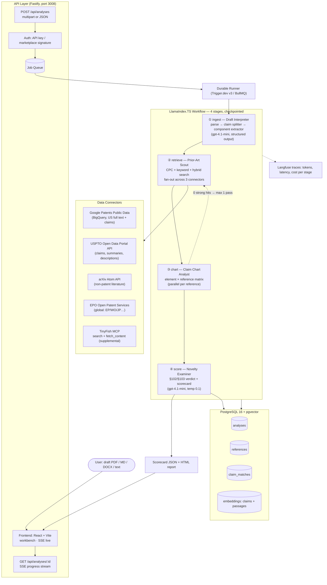

# AI Patent & Prior-Art Research Agent — Architecture & Technical Specification

Production-grade specification for building the agent described in [`README.md`](./README.md).
Read this document top-to-bottom before writing any code — it is the single source of truth for the build.
Feature-by-feature detail (behavior, edge cases, UI): [`FEATURES.md`](./FEATURES.md) · UI/UX specification (Ari persona, workbench, evidence inspector): [`UIUX.md`](./UIUX.md).

---

## 1. What The Agent Does (Product Definition)

**Input:** a draft invention disclosure — product architecture doc, algorithm description, technical paper draft, or patent claim sketch (PDF / Markdown / DOCX / LaTeX / pasted text).

**Output:** a **Patent Novelty Scorecard**:

1. **Novelty Score (0–100)** — how far the draft sits from the closest prior art.
2. **Per-claim overlap percentages** — each claim charted element-by-element against the closest references.
3. **Anticipation vs. obviousness verdict** — §102 (one reference discloses everything) vs. §103 (a combination renders it obvious).
4. **Highlighted conflicting passages** — the exact paragraphs/figures in each reference that map to a claim element, quoted.
5. **Closest reference callout + rewrite suggestions** — which limitation to add to restore distance from the nearest hit.
6. **Full citations** — every finding links to a Google Patents / USPTO / arXiv source.

**Who it is for:** technical founders, CTOs, IP teams at startups, and patent attorneys doing first-pass triage before a real attorney review.

**The 5-week problem it collapses:** manual prior-art search = keyword brainstorming → classification search → reading hundreds of PDFs → hand-built claim charts. This agent does stages 1–3 in ~4–6 minutes and drafts the claim chart automatically.

---

## 2. System Pattern: Staged Pipeline with Durable Execution & Bounded Refinement

The agent is a **sequential 4-stage pipeline** (LlamaIndex.TS `Workflow`) wrapped in a **durable task runner**, with **checkpoint-to-database after every stage** and a **bounded cross-reference refinement loop** (max 1 expansion pass).

### Why this pattern?

- **Legal precision over autonomy:** unlike a free-roaming research agent, patent analysis must be *literal and reproducible* — low temperature, deterministic schemas, every claim tied to a quoted passage. A fixed pipeline beats an open-ended loop here.
- **Checkpointing beats raw speed:** a run takes 4–6 minutes and touches external APIs (LLM tokens; BigQuery bytes only when the optional connector is on). Every stage result is persisted, so a crash at stage 3 never loses the stage 1–2 spend, and the UI can render partial results live.
- **Durable execution:** the pipeline runs as a Trigger.dev v3 task (or BullMQ worker in self-hosted mode), shielding long runs from HTTP server timeouts.
- **Bounded refinement:** if the Claim Chart Analyst finds *zero* strong hits, one automatic query-expansion pass re-runs retrieval with broader CPC classes and synonym-expanded terms — then proceeds regardless. Never loops.

---

## 3. Architecture Diagram



---

## 4. Agents & Nodes Breakdown

| # | Stage / Node | Model / Tech | Function |
|---|---|---|---|
| **1** | **Draft Interpreter** | `gpt-4.1-mini`, structured output, temp 0.2 | Splits draft into independent + dependent claims, extracts components, rewrites technical approach in normalized terms |
| **2a** | **Query Formulator** | `gpt-4.1-mini` | Turns each claim into: 2 keyword queries (synonym-expanded), 1 CPC/IPC class guess, 1 embedding vector |
| **2b** | **Connector fan-out** | BigQuery / ODP / OPS / arXiv clients | Runs retrieval in parallel; each connector returns ≤ `MAX_CANDIDATES` normalized records |
| **2c** | **Candidate Ranker** | embedding cosine + recency + citation-count blend | De-duplicates (publication-number family merge) and ranks to top 50 |
| **3** | **Claim Chart Analyst** | `gpt-4.1-mini`, temp 0.1, one call per (claim × reference) | For each claim element: *disclosed / partial / not found* + quoted passage + paragraph locator. Runs in a bounded parallel map (concurrency 5) |
| **4** | **Novelty Examiner** | `gpt-4.1-mini`, temp 0.1 | Aggregates the matrix → novelty score, §102/§103 verdict, red flags, rewrite suggestions |

> **Model choice rationale:** charting is *literal* reading — small model, low temperature, JSON schema enforced. Only the final verdict step may be upgraded to `gpt-4.1` via env for higher-stakes runs.

---

## 5. Technology Stack (Production)

> **Full bill of materials** — every package, role, rejected alternative, and the complete `.env` reference: [`STACK.md`](./STACK.md).

| Layer | Choice | Version / notes |
|---|---|---|
| Language | TypeScript (strict) | Node 20+ |
| Agent framework | **LlamaIndex.TS** (`llamaindex`) | `Workflow` with typed step handlers, `OpenAI` model wrapper, `schema` structured outputs |
| API server | **Fastify** + `@fastify/multipart`, `@fastify/cors`, Zod schemas | OpenAPI via `@fastify/swagger` |
| Durable execution | **Trigger.dev v3** (managed) or **BullMQ + Redis** (self-hosted fallback) | Retries w/ exponential backoff, 15-min task ceiling |
| Database | **PostgreSQL 16 + pgvector** | via `pg` pool; migrations with `node-pg-migrate` |
| Vector search | **pgvector** (`ivfflat`, lists=100) | keeps one datastore; upgrade path to Qdrant if corpus > 10M passages |
| Patent data | **Free:** USPTO ODP (REST, `X-API-KEY`), EPO OPS (OAuth), arXiv · **Optional:** BigQuery (`FREE_MODE=false`, needs GCP card) | see §6 · budget tiers: STACK §15 |
| NPL | **arXiv Atom API**, **Semantic Scholar Graph API** | no-key / no-key-basic |
| Web context | **TinyFish MCP** (`search` + `fetch_content`) | same key resolution as CompetitorAgent |
| LLM | **Free-first chain** — Groq (`gpt-oss-120b`, no card) → Gemini free → Ollama local → OpenAI `gpt-4.1-mini` (paid, at revenue) | ordered env fallback; structured output via JSON mode + Zod retry |
| Embeddings | `text-embedding-3-small` (1536-dim) | pgvector column `vector(1536)` |
| Observability | **Langfuse** (traces, per-stage token/cost, dataset evals) | optional; no-op if keys absent |
| Frontend | **React 19 + Vite + TypeScript** — component workbench, EventSource SSE hook, Motion animations | dev on :5173 (proxy), prod build served by Fastify |
| Payments | **PayPal** — Orders API (`intent: AUTHORIZE` + capture-less-than-authorized), Vault pre-approved billing (agent buyers), Payouts to developers, verified webhooks | sandbox-first; `PayPal-Request-Id` = `run_id` for idempotency |
| File parsing | `pdf-parse`, `mammoth` (DOCX), `gray-matter`+custom (LaTeX), `marked` (MD) | all in `src/parse/` |
| Deploy | Docker (single image) or Fly.io/Railway; Trigger.dev runner as second process | see §12 |
| Secrets | `.env` locally; cloud secret manager in prod | never in DB |

---

## 6. Data Connectors — Exact Integration Spec

### 6.1 Google Patents Public Data (BigQuery) — primary US full-text source

- **Dataset:** `patents-public-data.patents.publications` (worldwide bibliographic; **US full text incl. claims**). Provided by IFI CLAIMS.
- **Optional in budget mode:** in `FREE_MODE=true` (default for development) this connector is skipped entirely — US claims come from USPTO ODP and global coverage from EPO OPS (both free, no card). See STACK §15.
- **Requires (when enabled):** GCP project + billing account + BigQuery read permission (service account, read-only IAM role).
- **⚠️ Cost guard is mandatory:** the table is ~100M+ rows and ~100s of GB per full scan. Every query **must** be pinned — never `SELECT *` without a filter. Patterns that keep bytes-scanned low:

```sql
-- 1) Exact lookup (used when enriching known publication numbers) — scans 1 row
SELECT publication_number, title, abstract, claims, cpc, priority_date, publication_date
FROM `patents-public-data.patents.publications`
WHERE publication_number IN ('US11234567B2', 'US20210123456A1');

-- 2) CPC-class + date-window search — partition-pruned
SELECT publication_number, title, abstract, SUBSTR(claims, 1, 8000) AS claims_head
FROM `patents-public-data.patents.publications`
WHERE publication_type = 'grant'
  AND REGEXP_CONTAINS(cpc, r'G06N.?3/08')          -- target CPC class
  AND publication_date >= '20150101'
ORDER BY publication_date DESC
LIMIT 200;
```

- **Notes:** `claims` is a STRUCT/array in the current schema — normalize to plain text on ingest. Family de-duplication by `family_id` when present.
- **Guardrails in code:** wrap every query with a `maximum_bytes_billed` (default 1 GB) on the job config; on `tooLarge` error, fail the connector gracefully and continue with remaining sources.

### 6.2 USPTO Open Data Portal (ODP) — official US claims

- **Auth:** free ODP API key (MyUSPTO account → data.uspto.gov → API keys). Sent as `X-API-KEY` header. **Legacy PatentsView keys (`search.patentsview.org`) stopped working in the March 2026 ODP migration — do not ship code that uses them.**
- **Base:** `https://data.uspto.gov` — endpoints for patent search + application/file-wrapper data (v1/v2 families). Long-text bulk tables (`g_claims_*`, `pg_claims_*`, `*_detail_desc_text_*`) are also downloadable via ODP bulk datasets if we later want a local claims cache.
- **Usage in pipeline:** enrichment step — given publication numbers from stage 2, fetch authoritative claim text so the chart step quotes the *official* claim language, not BigQuery's rendering.
- **Rate discipline:** queue calls, 2 concurrent max, honor `Retry-After` on 429.

### 6.3 EPO Open Patent Services (OPS) — global coverage

- **Auth:** registered key → OAuth2 client-credentials → bearer token (cached until expiry).
- **Use:** WIPO/EP/JP/KR filings that BigQuery's US-full-text coverage misses; `published-data/search/cql` queries, JSON via `Accept: application/json`.
- **Quotas:** ~4 GB/day and 4 req/s (burst 8) — token-bucket in the connector.

### 6.4 arXiv + Semantic Scholar — non-patent literature (NPL)

- **arXiv:** `http://export.arxiv.org/api/query?search_query=all:...&max_results=20` (Atom XML, **no key**, **≥3 s between requests** — enforced by an internal rate limiter). NPL matters: papers published before the draft's priority date can be §102 art.
- **Semantic Scholar:** `https://api.semanticscholar.org/graph/v1/paper/search` — free tier, no key for light use; used for citation-chasing around arXiv hits.

### 6.5 TinyFish MCP — supplemental context

- Same client pattern as CompetitorAgent: MCP at `https://agent.tinyfish.ai/mcp` with `X-API-KEY`, key resolved from `TINYFISH_API_KEY` → `~/.tinyfish/config.json`.
- Used for: company tech blogs, standards docs, product pages — surfaced as **contextual NPL**, clearly labeled `kind: "web"` in the scorecard (weaker than patent/paper art, but useful signal).

---

## 7. Feature List

### Core (v1 — build now)

1. **Draft ingestion** — PDF, DOCX, Markdown, LaTeX, pasted text; 20k-char guard.
2. **Automatic claim decomposition** — independent + dependent claims + element split.
3. **Hybrid prior-art retrieval** — CPC class + keyword + embedding similarity, 4 patent/literature sources.
4. **Family de-duplication** — same patent family collapsed to one representative.
5. **Claim-chart generation** — element × reference matrix with quoted passages and locators.
6. **Novelty Scorecard** — score, §102/§103 verdict, per-claim overlap %, red flags, rewrite suggestions.
7. **Live progress UI** — SSE stage stream (ingest → retrieve → chart → score), partial results as they land.
8. **History** — past analyses list, re-open, delete.
9. **Graceful degradation** — missing BigQuery/ODP keys → NPL-only run, scorecard clearly flags reduced coverage.
10. **Health endpoint** — per-dependency status for the marketplace ping test (`GET /health` → `{ status, uptime, deps }`).

### Production hardening (v1.1)

11. **Auth** — per-key auth + `X-Marketplace-Signature` verification (marketplace ping-test compatible).
12. **Cost telemetry per run** — LLM tokens + BigQuery bytes + connector calls recorded per analysis (needed for cost-plus pricing on the marketplace).
13. **Durable runner** — Trigger.dev v3 tasks (retries, backoff) with BullMQ fallback for self-hosting.
14. **Langfuse tracing** — spans per stage, token/cost dashboards.
15. **Caching** — publication-number lookups cached in Postgres (patents never change) with `ETag`-less TTL of 30 days; embeddings cached forever by content hash.
16. **Rate-limit everything** — token buckets per connector; global per-tenant concurrency cap.

### Later (v2+)

17. **FTO mode** — flip the chart: given *your granted patent* + a target product, map product features to your claims (infringement direction).
18. **Family/legal-status view** — is the closest reference granted, pending, or expired? (expired = free to practice).
19. **Watch monitors** — TinyFish Monitor on a CPC class → alert when new filings land in your space.
20. **Export** — attorney-ready `.docx` claim chart + PDF scorecard.
21. **Multi-jurisdiction** — EPO/WO-first analysis for non-US filings.

---

## 8. The Scoring Algorithm (normative)

```
overlap(claim, ref) = Σ w(element_i) · match(element_i, ref) / Σ w(element_i)
    match ∈ {disclosed=1.0, partial=0.5, not_found=0.0}
    w(independent element) = 1.0 ; w(dependent claim element) = 0.7

claim_risk(claim) =
    §102  if ∃ ref : overlap(claim, ref) = 1.0          → anticipation (worst)
    §103  if ∃ refs (2–3) : Σ overlap across refs ≥ 0.9 and no single ref = 1.0
    clear otherwise

novelty_score = 100 − 100 · max_risk                    # max_risk = max over independent claims,
                                                        #   blended 0.7/0.3 with dependent-claim average
```

- Temperature 0.1 everywhere in stage 3–4; identical input → identical chart (deterministic enough to cache by content hash).
- The score is **directional**, and the UI always shows the disclaimer + "closest reference" so users see *why* a score is low.

---

## 9. Data Model (Postgres)

> The **authoritative, executable schema** (all tables: tenants, api_keys, agent_listings, analyses, claims, claim_elements, references_, claim_matches, agent_messages, embeddings, caches, billing_records, run_costs, paypal_webhook_events, watch_monitors + views, RLS, capacity notes) lives in [`DATABASE.md`](./DATABASE.md) and ships verbatim as `db/001_init.sql`. Summary below.

```sql
CREATE EXTENSION IF NOT EXISTS vector;

CREATE TABLE analyses (
  id            UUID PRIMARY KEY DEFAULT gen_random_uuid(),
  tenant_id     TEXT NOT NULL,               -- marketplace buyer/tenant scope
  run_id        TEXT UNIQUE,                 -- marketplace-owned run id (idempotency key for /execute)
  status        TEXT NOT NULL,              -- queued|ingesting|retrieving|charting|scoring|complete|failed
  stage         TEXT,
  input_kind    TEXT,                       -- pdf|docx|md|latex|text
  draft_hash    TEXT,                       -- sha256, dedupe + cache key (result cache is tenant-scoped)
  novelty_score INT,
  verdict       TEXT,                       -- clear|obviousness|anticipation|partial-overlap
  result        JSONB,                      -- full scorecard
  cost          JSONB,                      -- {llm_tokens, bigquery_bytes, connector_calls, billable_seconds}
  billing       JSONB,                      -- {mode, rate, minutes, price, currency, paypal_auth_id}
  created_at    TIMESTAMPTZ DEFAULT now(),
  completed_at  TIMESTAMPTZ
);

CREATE INDEX ON analyses (tenant_id, created_at DESC);

CREATE TABLE references_ (
  id                 BIGSERIAL PRIMARY KEY,
  analysis_id        UUID REFERENCES analyses(id) ON DELETE CASCADE,
  publication_number TEXT,
  kind               TEXT,                  -- patent|npl|web
  office             TEXT,                  -- US|WO|EP|arXiv…
  title              TEXT,
  url                TEXT,
  matched_elements   TEXT,
  rank               INT
);

CREATE TABLE claim_matches (
  id            BIGSERIAL PRIMARY KEY,
  analysis_id   UUID REFERENCES analyses(id) ON DELETE CASCADE,
  claim_id      TEXT,
  element_text  TEXT,
  match         TEXT,                       -- disclosed|partial|not_found
  reference_id  BIGINT REFERENCES references_(id) ON DELETE CASCADE,
  quote         TEXT,
  locator       TEXT                        -- paragraph / section pointer
);

CREATE TABLE embeddings (
  id         BIGSERIAL PRIMARY KEY,
  kind       TEXT,                          -- claim|passage
  ref_key    TEXT,                          -- publication_number or content hash
  content    TEXT,
  embedding  vector(1536)
);
CREATE INDEX ON embeddings USING ivfflat (embedding vector_cosine_ops) WITH (lists = 100);
```

**Multi-tenant rule:** every row carries `tenant_id`, and every query is tenant-scoped — three concurrent buyers of one published agent share no rows. Read-caches (publication text, embeddings) are content-keyed and immutable, hence safe to share; result caches (draft hash → scorecard) are tenant-scoped so buyers never see each other's drafts.

---

## 10. API Contract (v1)

| Method | Route | Notes |
|---|---|---|
| `POST` | `/api/analyses` | multipart file **or** `{ text, jurisdiction?, max_references? }` → `202 { id, status, stage }` |
| `GET` | `/api/analyses/:id` | full row; `result` present when `status=complete` |
| `GET` | `/api/analyses/:id/stream` | SSE: `stage`, `progress`, `partial_result`, `agent_msg {from,to,template_id,payload}`, `ari_line {template_id,payload}` events — the same events drive the UI, the Team Rail dialogue, and the Mission-Control graph (truthful by construction) |
| `GET` | `/api/analyses?limit=20` | recent history |
| `DELETE` | `/api/analyses/:id` | hard delete + cascade |
| `GET` | `/health` | `{ status:"ready", uptime, deps:{ bigquery, odp, arxiv, postgres } }` — marketplace ping-test shape |
| `POST` | `/execute` | `{ run_id, tenant_id, dryRun?, payload }` — marketplace BYOS invoke endpoint. **Run id is owned by the marketplace**; the job is registered in the durable engine keyed by it. Resubmitting the same `run_id` is idempotent (returns the existing job, never starts a duplicate). `dryRun` validates env/runner and exercises the billing meter without spending credits |

Auth middleware: `Authorization: Bearer <API_KEY>` or `X-Marketplace-Signature` (HMAC of timestamp+body with the seller secret).

---

## 11. Cost & Rate Guardrails

| Guard | Value | Why |
|---|---|---|
| BigQuery `maximum_bytes_billed` | 1 GB / query | prevents an unfiltered scan from burning the GCP budget |
| `MAX_CANDIDATES` | 50 | bounds stage-3 fan-out |
| `MAX_CROSS_REFERENCED` | 10 (UI: 5/10/20) | deep charting is the expensive stage |
| Chart-call concurrency | 5 | keeps latency flat, provider QPS safe |
| Per-(claim × reference) char budget | 6 000 chars of reference text | token ceiling |
| Refinement passes | ≤ 1 | bounded loop — never re-retrieves twice |
| arXiv spacing | ≥ 3 s | their documented rate limit |
| Per-tenant concurrent runs | 2 (configurable) | fairness on shared keys |
| LLM temperature | 0.1 (stages 3–4) | literal charting, reproducibility |

### Billing guardrails (marketplace)

| Guard | Value | Why |
|---|---|---|
| `PRICING_MODE` | `runtime` \| `tier` | metered task-hours, or fixed tiers (Lite/Standard/Deep) |
| `RUNTIME_RATE` | e.g. `0.04` $/min | developer-set price per billable minute |
| `MIN_RUN_FEE` | `0.10` $ | floor for tiny runs |
| `MAX_RUN_FEE` | `1.50` $ | cap **and** the PayPal authorization amount — a run can never bill beyond it |
| Cap & stop rule | finish current stage → checkpoint → stop with partial scorecard + "top up to continue" | protects buyer from unbounded bills and dev from unbounded losses |

Metered pricing is justified by telemetry: wall-clock execution minutes correlate tightly with actual LLM-token + BigQuery cost (charting is 80%+ of both), and the per-run `cost` record proves the correlation per run.

Estimated steady-state cost per run (defaults, `gpt-4.1-mini`): **~$0.06–$0.12 LLM + ~$0.00–0.02 BigQuery + $0 external patent APIs** (all official patent/NPL sources are free-tier). **Budget mode** (`FREE_MODE=true`, Groq/Ollama + ODP/OPS): **$0.00 per run** — see STACK §15.

---

## 12. Deployment & "How To Build It" — ordered plan

### Phase 0 — skeleton (½ day)
1. `npm init`, TypeScript strict, Fastify hello-world on 3008, Docker Compose (Postgres 16 + pgvector), run `db/001_init.sql` on boot.
2. `/health` returning `{ status, uptime, deps }`.

### Phase 1 — ingestion (1 day)
3. `src/parse/documents.ts`: text + MD first, then `pdf-parse` → `mammoth` → LaTeX.
4. Stage ① LlamaIndex.TS workflow step with structured-output schema: `{ claims[], components[], approach }`.
5. Persist to `analyses` + checkpoint status.

### Phase 2 — retrieval (1–2 days)
6. `src/connectors/googlePatents.ts` — BigQuery with `maximum_bytes_billed`; CPC + keyword queries from §6.1.
7. `src/connectors/usptoOdp.ts` — `X-API-KEY`, 429 backoff; claims enrichment by publication number.
8. `src/connectors/arxiv.ts` — Atom parser + 3 s rate limiter.
9. Ranker + family de-dup → top-50 `references_` rows.

### Phase 3 — charting + scoring (1–2 days)
10. Stage ③ map: (claim × reference) calls, bounded parallelism, JSON-schema output, persist `claim_matches`.
11. Stage ④: scoring algorithm from §8 → scorecard JSON.
12. Retry/refinement rule: 0 strong hits → one synonym/CPC-expanded re-retrieval.

### Phase 4 — UX + durability (1 day)
13. React UI: SSE hook + workbench (submit → live stage bars → scorecard with per-claim overlap bars, expandable element charts, citation links, Team Rail).
14. Trigger.dev v3 task wrapping the workflow (BullMQ fallback documented).

### Phase 5 — production hardening (1–2 days)
15. Auth + `X-Marketplace-Signature` + `/execute` dry-run mode.
16. Cost telemetry per run (tokens, BigQuery bytes, connector calls) written to `analyses.cost`.
17. Langfuse tracing; caching layers (publication cache, embedding cache).
18. `npm test`: scoring math, claim splitter, schema recovery — no network needed.

### Runbook
```bash
cd Agents/AiPatentAgent
npm install
copy .env.example .env        # OPENAI_API_KEY, BIGQUERY_PROJECT_ID, USPTO_ODP_API_KEY…
docker compose up -d          # postgres:5437 + pgvector
npm run dev                   # API :3008 + React/Vite :5173 (open http://localhost:5173)
npm test                      # offline suite (API contract + scoring math + web component tests)
npm run worker                # durable runner (if BullMQ mode)
```

---

## 13. Legal Disclaimer (ship in product UI, not just docs)

This system produces **algorithmic triage, not legal advice**. Scores and charts are approximations; they can miss prior art, mis-read claim scope, and do not constitute an FTO opinion or create an attorney–client relationship. Every scorecard ships with the disclaimer and a "review with a registered patent attorney" banner.
