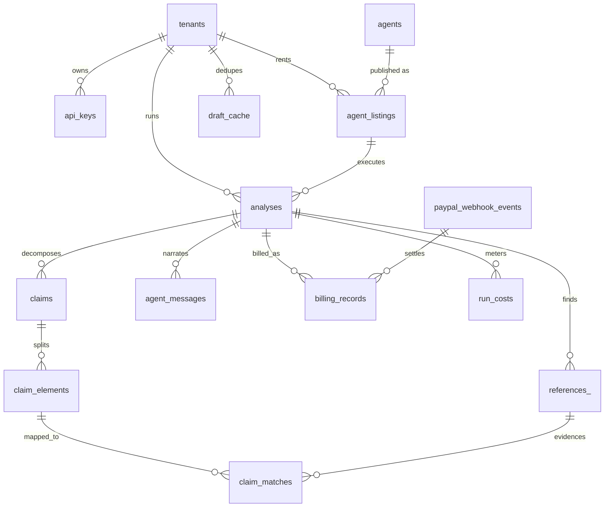
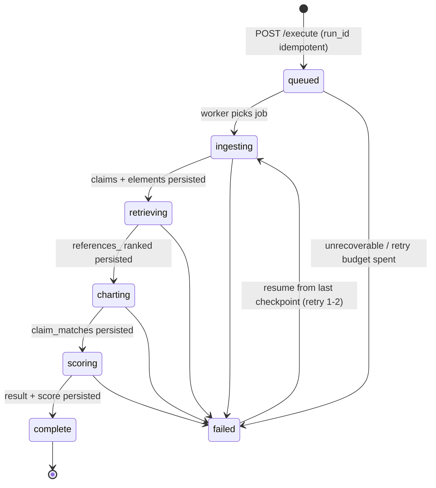
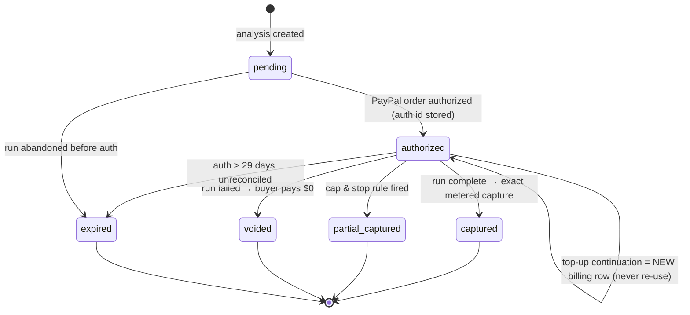

# AI Patent & Prior-Art Research Agent — Database Specification (PostgreSQL 16 + pgvector)

Single source of truth for the data layer. The SQL below is **executable as-is** and becomes `db/001_init.sql` (auto-run by Docker on first boot; later changes via `node-pg-migrate`).
Companion documents: [`README.md`](./README.md) · [`ARCHITECTURE.md`](./ARCHITECTURE.md) (§9 summary) · [`FEATURES.md`](./FEATURES.md).

**Design rules:**
1. **PostgreSQL only** — one datastore for rows, JSONB results, and vectors (`pgvector`). No Redis required (BullMQ mode adds it as an optional queue backend, never as a system of record).
2. **Every tenant-scoped table carries `tenant_id`** — three concurrent buyers of one published agent share no rows. All application queries are tenant-scoped by policy; the RLS role in §8 enforces it at the DB level too.
3. **Everything cascade-deletes from its analysis** — GDPR-style "delete my run" is one statement.
4. **Immutable facts vs mutable state** — publication text caches are immutable; analyses advance through statuses; billing advances through a state machine. Each gets its own table, never overloaded JSONB.
5. **JSONB where querying isn't needed, columns where it is** — the full scorecard lives in `analyses.result`, but anything filtered/joined (status, verdict, score, tenant, publication number) is a real column with an index.

---

## 1. Entity Relationship Overview



---

## 2. Enums

```sql
CREATE TYPE analysis_status AS ENUM
  ('queued','ingesting','retrieving','charting','scoring','complete','failed');
CREATE TYPE claim_type      AS ENUM ('independent','dependent');
CREATE TYPE reference_kind  AS ENUM ('patent','npl','web');
CREATE TYPE match_type      AS ENUM ('disclosed','partial','not_found');
CREATE TYPE verdict_type    AS ENUM ('clear','obviousness','anticipation','partial_overlap');
CREATE TYPE billing_mode    AS ENUM ('runtime','tier');
CREATE TYPE billing_state   AS ENUM
  ('pending','authorized','captured','partial_captured','voided','expired');
CREATE TYPE agent_role      AS ENUM ('ari','scout','clerk','cartographer','examiner');
```

---

## 3. Full Schema

```sql
CREATE EXTENSION IF NOT EXISTS vector;
CREATE EXTENSION IF NOT EXISTS pgcrypto;          -- gen_random_uuid()

-- ============================================================
-- TENANTS & AUTH (F11)
-- ============================================================
CREATE TABLE tenants (
  id          UUID PRIMARY KEY DEFAULT gen_random_uuid(),
  name        TEXT NOT NULL,
  created_at  TIMESTAMPTZ NOT NULL DEFAULT now()
);

CREATE TABLE api_keys (
  id          UUID PRIMARY KEY DEFAULT gen_random_uuid(),
  tenant_id   UUID NOT NULL REFERENCES tenants(id) ON DELETE CASCADE,
  key_hash    TEXT NOT NULL UNIQUE,               -- sha256, never store raw keys
  label       TEXT NOT NULL DEFAULT 'default',
  created_at  TIMESTAMPTZ NOT NULL DEFAULT now(),
  revoked_at  TIMESTAMPTZ
);

-- ============================================================
-- PUBLISHED AGENT LISTING (marketplace side of one dev → N buyers)
-- ============================================================
CREATE TABLE agent_listings (
  id             UUID PRIMARY KEY DEFAULT gen_random_uuid(),
  slug           TEXT NOT NULL UNIQUE,             -- 'ai-patent-agent'
  developer      TEXT NOT NULL,
  pricing_mode   billing_mode NOT NULL DEFAULT 'runtime',
  runtime_rate   NUMERIC(8,4),                     -- $ per billable minute
  min_run_fee    NUMERIC(8,2) DEFAULT 0.10,
  max_run_fee    NUMERIC(8,2) DEFAULT 1.50,        -- == PayPal authorization amount
  tenant_daily_cap NUMERIC(8,2) DEFAULT 20.00,
  tiers          JSONB,                            -- [{name:'Lite', price:0.10, caps:{claims:4, refs:5}}, …]
  paypal_payout_email TEXT,
  created_at     TIMESTAMPTZ NOT NULL DEFAULT now()
);

-- ============================================================
-- ANALYSES — one row per run (core table)
-- ============================================================
CREATE TABLE analyses (
  id             UUID PRIMARY KEY DEFAULT gen_random_uuid(),
  tenant_id      UUID NOT NULL REFERENCES tenants(id) ON DELETE CASCADE,
  listing_id     UUID REFERENCES agent_listings(id),
  run_id         TEXT UNIQUE,                      -- marketplace-owned idempotency key for /execute
  revision       INT NOT NULL DEFAULT 1,           -- sub-runs (F24 what-if re-checks) bump this
  parent_id      UUID REFERENCES analyses(id) ON DELETE CASCADE,
  status         analysis_status NOT NULL DEFAULT 'queued',
  stage          TEXT,
  input_kind     TEXT,                             -- pdf|docx|md|latex|text
  input_name     TEXT,                             -- original filename
  draft_hash     TEXT NOT NULL,                    -- sha256 → dedupe + result cache
  draft_chars    INT,
  novelty_score  INT CHECK (novelty_score BETWEEN 0 AND 100),
  verdict        verdict_type,
  result         JSONB,                            -- full scorecard (see §5)
  error          JSONB,                            -- {stage, message, retriable}
  created_at     TIMESTAMPTZ NOT NULL DEFAULT now(),
  started_at     TIMESTAMPTZ,
  completed_at   TIMESTAMPTZ
);
CREATE INDEX idx_analyses_tenant       ON analyses (tenant_id, created_at DESC);
CREATE INDEX idx_analyses_status       ON analyses (status) WHERE status NOT IN ('complete','failed');
CREATE INDEX idx_analyses_result_gin   ON analyses USING gin (result jsonb_path_ops);
CREATE INDEX idx_analyses_parent       ON analyses (parent_id);

-- ============================================================
-- CLAIMS & ELEMENTS (F2)
-- ============================================================
CREATE TABLE claims (
  id          BIGSERIAL PRIMARY KEY,
  analysis_id UUID NOT NULL REFERENCES analyses(id) ON DELETE CASCADE,
  claim_no    INT NOT NULL,                        -- 1, 2, 3…
  type        claim_type NOT NULL,
  provisional BOOLEAN NOT NULL DEFAULT false,      -- agent-drafted vs user's own
  text        TEXT NOT NULL,
  source_map  JSONB,                               -- page/line pointers into the user's draft
  UNIQUE (analysis_id, claim_no)
);

CREATE TABLE claim_elements (
  id          BIGSERIAL PRIMARY KEY,
  claim_id    BIGINT NOT NULL REFERENCES claims(id) ON DELETE CASCADE,
  element_no  INT NOT NULL,
  text        TEXT NOT NULL,
  weight      NUMERIC(3,2) NOT NULL DEFAULT 1.00,  -- 1.0 independent / 0.7 dependent
  UNIQUE (claim_id, element_no)
);
```

> Note: claims belong to a *revision* of an analysis. Sub-runs (F24) create a new `analyses` row (`parent_id`, `revision+1`) **copying** claim rows forward — claims tables stay append-only per revision, which keeps historical scorecards reproducible.

```sql
-- ============================================================
-- REFERENCES (prior-art candidates) (F3/F4)
-- ============================================================
CREATE TABLE references_ (
  id                 BIGSERIAL PRIMARY KEY,
  analysis_id        UUID NOT NULL REFERENCES analyses(id) ON DELETE CASCADE,
  publication_number TEXT,                          -- normalized: 'US11234567B2'
  family_id          TEXT,                          -- de-dup grouping
  kind               reference_kind NOT NULL,
  office             TEXT,                          -- US|WO|EP|arXiv|web
  title              TEXT,
  assignee           TEXT,
  cpc                TEXT,
  priority_date      DATE,
  publication_date   DATE,
  url                TEXT NOT NULL,
  rank_score         NUMERIC(5,3),
  rank_breakdown     JSONB,                         -- {cosine, keyword, cpc, recency, citations}
  selected           BOOLEAN NOT NULL DEFAULT false,-- made the deep-chart shortlist
  snippet            TEXT,                          -- ≤6k chars text actually sent to the chart step
  source             TEXT                           -- connector provenance (arxiv|uspto-odp|epo-ops|bigquery|tinyfish) — F9
);
CREATE INDEX idx_refs_analysis ON references_ (analysis_id, rank_score DESC);
-- Plain (non-partial) unique index: PG can infer it for ON CONFLICT, and NULLs stay distinct
CREATE UNIQUE INDEX uq_refs_pubnum ON references_ (analysis_id, publication_number);

-- ============================================================
-- CLAIM CHART (F5) — element × reference matrix
-- ============================================================
CREATE TABLE claim_matches (
  id           BIGSERIAL PRIMARY KEY,
  analysis_id  UUID NOT NULL REFERENCES analyses(id) ON DELETE CASCADE,
  claim_id     BIGINT NOT NULL REFERENCES claims(id) ON DELETE CASCADE,
  element_id   BIGINT NOT NULL REFERENCES claim_elements(id) ON DELETE CASCADE,
  reference_id BIGINT NOT NULL REFERENCES references_(id) ON DELETE CASCADE,
  match        match_type NOT NULL,
  quote        TEXT,                               -- verbatim substring of reference text (checked)
  locator      TEXT,                               -- ¶0031 / col 4 ll.12–20
  commentary   TEXT,                               -- Ari's one-liner for the inspector
  UNIQUE (element_id, reference_id)
);
CREATE INDEX idx_matches_analysis ON claim_matches (analysis_id, match);

-- ============================================================
-- TEAM RAIL — persisted agent-to-agent messages (F26/F27)
-- (SSE drives live rendering; this table powers refresh-rehydration + replay scrubber)
-- ============================================================
CREATE TABLE agent_messages (
  id           BIGSERIAL PRIMARY KEY,
  analysis_id  UUID NOT NULL REFERENCES analyses(id) ON DELETE CASCADE,
  seq          INT NOT NULL,                       -- monotonic within the run → replay order
  from_agent   agent_role NOT NULL,
  to_agent     agent_role NOT NULL,
  template_id  TEXT NOT NULL,                      -- pre-authored template (truthful by construction)
  payload      JSONB NOT NULL,                     -- {claim_no, reference_id, quote…}
  created_at   TIMESTAMPTZ NOT NULL DEFAULT now(),
  UNIQUE (analysis_id, seq)
);

-- ============================================================
-- EMBEDDINGS (F3 hybrid search, F25 grounded follow-up)
-- ============================================================
CREATE TABLE embeddings (
  id         BIGSERIAL PRIMARY KEY,
  scope      TEXT NOT NULL,                        -- 'global' | analysis uuid
  kind       TEXT NOT NULL,                        -- 'claim'|'passage'
  ref_key    TEXT,                                 -- publication_number or content hash
  content    TEXT NOT NULL,
  content_hash TEXT NOT NULL,                      -- sha256 → idempotent upsert, cache key
  embedding  vector(1536) NOT NULL,                -- budget mode: use vector(384) (local bge-small, STACK §15)
  created_at TIMESTAMPTZ NOT NULL DEFAULT now(),
  UNIQUE (content_hash, kind)
);
CREATE INDEX idx_emb_scope  ON embeddings (scope, kind);
CREATE INDEX idx_emb_vector ON embeddings USING ivfflat (embedding vector_cosine_ops) WITH (lists = 100);

-- ============================================================
-- CACHES (F15) — immutable facts only
-- ============================================================
CREATE TABLE publication_cache (                    -- patent text is immutable → long TTL
  publication_number TEXT PRIMARY KEY,
  payload            JSONB NOT NULL,                -- {title, abstract, claims, cpc, dates, office}
  source             TEXT NOT NULL,                 -- 'bigquery'|'odp'|'ops'
  fetched_at         TIMESTAMPTZ NOT NULL DEFAULT now(),
  expires_at         TIMESTAMPTZ NOT NULL DEFAULT now() + INTERVAL '30 days'
);

CREATE TABLE draft_cache (                          -- tenant-scoped result cache (never cross-tenant)
  tenant_id   UUID NOT NULL REFERENCES tenants(id) ON DELETE CASCADE,
  draft_hash  TEXT NOT NULL,
  analysis_id UUID NOT NULL REFERENCES analyses(id) ON DELETE CASCADE,
  created_at  TIMESTAMPTZ NOT NULL DEFAULT now(),
  expires_at  TIMESTAMPTZ NOT NULL DEFAULT now() + INTERVAL '30 days',
  PRIMARY KEY (tenant_id, draft_hash)
);

-- ============================================================
-- BILLING & TELEMETRY (F12) — PayPal metered task-hour model
-- ============================================================
CREATE TABLE billing_records (
  id                 UUID PRIMARY KEY DEFAULT gen_random_uuid(),
  analysis_id        UUID NOT NULL UNIQUE REFERENCES analyses(id) ON DELETE CASCADE,
  run_id             TEXT NOT NULL,
  tenant_id          UUID NOT NULL REFERENCES tenants(id) ON DELETE CASCADE,
  mode               billing_mode NOT NULL,
  rate               NUMERIC(8,4),                  -- $/min (runtime mode)
  tier_name          TEXT,                          -- (tier mode)
  billable_seconds   INT NOT NULL DEFAULT 0,        -- execution time, excludes queue wait
  price              NUMERIC(8,2),                  -- final captured amount
  currency           TEXT NOT NULL DEFAULT 'USD',
  state              billing_state NOT NULL DEFAULT 'pending',
  paypal_auth_id     TEXT,                          -- authorization id
  paypal_capture_id  TEXT,
  created_at         TIMESTAMPTZ NOT NULL DEFAULT now(),
  updated_at         TIMESTAMPTZ NOT NULL DEFAULT now()
);
CREATE INDEX idx_billing_state ON billing_records (state) WHERE state IN ('pending','authorized');

CREATE TABLE run_costs (                            -- cost telemetry → profit-per-run + pricing audits
  analysis_id       UUID PRIMARY KEY REFERENCES analyses(id) ON DELETE CASCADE,
  llm_tokens_in     INT NOT NULL DEFAULT 0,
  llm_tokens_out    INT NOT NULL DEFAULT 0,
  bigquery_bytes    BIGINT NOT NULL DEFAULT 0,
  connector_calls   JSONB NOT NULL DEFAULT '{}',    -- {bigquery:3, odp:10, arxiv:3, tinyfish:2}
  est_cost_usd      NUMERIC(8,4) NOT NULL DEFAULT 0,
  measured_at       TIMESTAMPTZ NOT NULL DEFAULT now()
);

CREATE TABLE paypal_webhook_events (                -- idempotent webhook inbox (never double-charge)
  event_id     TEXT PRIMARY KEY,                    -- PayPal event id — replay-safe
  event_type   TEXT NOT NULL,                       -- PAYMENT.CAPTURE.COMPLETED …
  payload      JSONB NOT NULL,
  received_at  TIMESTAMPTZ NOT NULL DEFAULT now(),
  processed_at TIMESTAMPTZ
);

-- ============================================================
-- CPC WATCH MONITORS (v2, F19)
-- ============================================================
CREATE TABLE watch_monitors (
  id           UUID PRIMARY KEY DEFAULT gen_random_uuid(),
  tenant_id    UUID NOT NULL REFERENCES tenants(id) ON DELETE CASCADE,
  cpc_class    TEXT,
  assignee     TEXT,
  keywords     TEXT[],
  schedule_cron TEXT NOT NULL DEFAULT '0 9 * * 1',  -- Mondays 09:00
  last_run_at  TIMESTAMPTZ,
  created_at   TIMESTAMPTZ NOT NULL DEFAULT now()
);

-- ============================================================
-- VIEWS — developer economics dashboard
-- ============================================================
CREATE VIEW v_run_economics AS
SELECT a.id, a.tenant_id, a.created_at, a.novelty_score, a.verdict,
       b.price, b.billable_seconds, b.state AS billing_state,
       c.est_cost_usd, b.price - c.est_cost_usd AS margin_usd
FROM analyses a
LEFT JOIN billing_records b ON b.analysis_id = a.id
LEFT JOIN run_costs      c ON c.analysis_id = a.id
WHERE a.status = 'complete';

CREATE VIEW v_tenant_usage AS
SELECT tenant_id,
       count(*)                                     AS runs_30d,
       sum(billable_seconds)                        AS seconds_30d,
       sum(price)                                   AS spend_30d,
       max(created_at)                              AS last_run_at
FROM billing_records
WHERE created_at > now() - INTERVAL '30 days'
GROUP BY tenant_id;

-- ============================================================
-- UPDATED-AT TRIGGER
-- ============================================================
CREATE OR REPLACE FUNCTION touch_updated_at() RETURNS trigger AS $$
BEGIN NEW.updated_at = now(); RETURN NEW; END $$ LANGUAGE plpgsql;
CREATE TRIGGER trg_billing_touch BEFORE UPDATE ON billing_records
  FOR EACH ROW EXECUTE FUNCTION touch_updated_at();
```

---

## 4. Row Lifecycle Walkthrough (one standard run)

| Moment | Rows written |
|---|---|
| `POST /execute` accepted | `analyses` (status `queued`, run_id, tenant, draft_hash) · `billing_records` (state `pending`) |
| PayPal authorization approved | `billing_records.state = 'authorized'`, `paypal_auth_id` |
| Stage ① done | `claims` + `claim_elements` rows; `analyses.status='retrieving'` |
| Stage ② streaming | `references_` rows (rank, breakdown, snippets) · `embeddings` upserts (content-hash idempotent) · `agent_messages` seq 1..n |
| Stage ③ streaming | `claim_matches` rows (quote validated verbatim in app) · more `agent_messages` |
| Stage ④ done | `analyses.result` (scorecard JSONB), `novelty_score`, `verdict`, `status='complete'` · `run_costs` row · `billing_records.price` computed |
| PayPal capture webhook | `paypal_webhook_events` (idempotent by event_id) → `billing_records.state='captured'`, `paypal_capture_id` |
| Failure | `analyses.status='failed'`, `error` JSONB · webhook void → `billing_records.state='voided'`, price $0 |
| Cap & stop | `billing_records.state='partial_captured'` + partial scorecard in `result` |
| What-if re-check (F24) | **new** `analyses` row (`parent_id`, `revision+1`), claims copied forward, only affected `claim_matches` recomputed |
| User deletes run | cascade removes analyses → claims → elements → matches → references → messages → billing/costs |

---

## 5. Scorecard JSONB shape (`analyses.result`)

```jsonc
{
  "novelty_score": 62,
  "verdict": "partial_overlap",
  "coverage": { "sources": ["google_bigquery","uspto_odp","arxiv"], "missing": ["epo_ops"] },
  "closest_reference": { "publication_number": "US11234567B2", "url": "…", "anticipates": "claim 1 (partial)" },
  "claims": [ { "claim_no": 1, "type": "independent", "overlap_pct": 71, "risk": "obviousness",
                "elements": [ { "element_no": 3, "match": "partial", "reference_id": 17, "quote": "…", "locator": "¶0031" } ] } ],
  "red_flags": [ "Claim 1 is one element from anticipation…" ],
  "rewrite_suggestions": [ "Claim 1: add the cloud-gateway fallback limitation…" ],
  "sources": [ … ]
}
```

GIN-indexed via `jsonb_path_ops` for ad-hoc queries (e.g. "all runs where verdict = anticipation"), but dashboards should use the real columns.

---

## 6. Access & Isolation Rules (executable)

**Roles** — created by the migration role, never used by the app at runtime:

```sql
-- migration/owner role (runs db/00x_*.sql, owns objects, bypasses RLS)
CREATE ROLE patent_migrator LOGIN PASSWORD '<secret>';
-- application role (used by src/store/db.ts)
CREATE ROLE patent_app    LOGIN PASSWORD '<secret>';
GRANT CONNECT ON DATABASE patent_agent TO patent_app;
GRANT USAGE, CREATE ON SCHEMA public TO patent_app;
GRANT SELECT, INSERT, UPDATE, DELETE ON ALL TABLES IN SCHEMA public TO patent_app;
GRANT USAGE, SELECT ON ALL SEQUENCES IN SCHEMA public TO patent_app;
```

**Row-Level Security** — a forgotten `WHERE tenant_id = …` cannot leak another buyer's scorecard:

```sql
-- helper: resolve an analysis's tenant for child tables
CREATE FUNCTION analysis_tenant(a_id uuid) RETURNS uuid LANGUAGE sql STABLE AS
$$ SELECT tenant_id FROM analyses WHERE id = a_id $$;

-- direct tenant tables
ALTER TABLE tenants        ENABLE ROW LEVEL SECURITY;
ALTER TABLE api_keys       ENABLE ROW LEVEL SECURITY;
ALTER TABLE analyses       ENABLE ROW LEVEL SECURITY;
ALTER TABLE draft_cache    ENABLE ROW LEVEL SECURITY;
ALTER TABLE billing_records ENABLE ROW LEVEL SECURITY;
ALTER TABLE watch_monitors ENABLE ROW LEVEL SECURITY;

CREATE POLICY p_tenants ON tenants USING (id = current_setting('app.tenant_id')::uuid);
CREATE POLICY p_api_keys ON api_keys USING (tenant_id = current_setting('app.tenant_id')::uuid);
CREATE POLICY p_analyses ON analyses
  USING      (tenant_id = current_setting('app.tenant_id')::uuid)
  WITH CHECK (tenant_id = current_setting('app.tenant_id')::uuid);
CREATE POLICY p_draft_cache ON draft_cache USING (tenant_id = current_setting('app.tenant_id')::uuid);
CREATE POLICY p_billing ON billing_records USING (tenant_id = current_setting('app.tenant_id')::uuid);
CREATE POLICY p_monitors ON watch_monitors USING (tenant_id = current_setting('app.tenant_id')::uuid);

-- child tables: resolve tenant through the parent analysis
ALTER TABLE claims          ENABLE ROW LEVEL SECURITY;
ALTER TABLE claim_elements  ENABLE ROW LEVEL SECURITY;
ALTER TABLE references_     ENABLE ROW LEVEL SECURITY;
ALTER TABLE claim_matches   ENABLE ROW LEVEL SECURITY;
ALTER TABLE agent_messages  ENABLE ROW LEVEL SECURITY;
ALTER TABLE run_costs       ENABLE ROW LEVEL SECURITY;

CREATE POLICY p_claims ON claims USING
  (analysis_tenant(analysis_id) = current_setting('app.tenant_id')::uuid);
CREATE POLICY p_elements ON claim_elements USING
  (analysis_tenant((SELECT analysis_id FROM claims WHERE id = claim_id)) =
   current_setting('app.tenant_id')::uuid);
CREATE POLICY p_refs ON references_ USING
  (analysis_tenant(analysis_id) = current_setting('app.tenant_id')::uuid);
CREATE POLICY p_matches ON claim_matches USING
  (analysis_tenant(analysis_id) = current_setting('app.tenant_id')::uuid);
CREATE POLICY p_messages ON agent_messages USING
  (analysis_tenant(analysis_id) = current_setting('app.tenant_id')::uuid);
CREATE POLICY p_costs ON run_costs USING
  (analysis_tenant(analysis_id) = current_setting('app.tenant_id')::uuid);

-- shared, immutable tables: NO RLS (by design)
--   publication_cache : patent facts, identical for every buyer (dedupe win)
--   embeddings        : scoped via 'scope' column — RLS there would kill vector search;
--                       app-level scope filter enforced in db.ts + contract tests
--   paypal_webhook_events : provider-global inbox; processed only by the webhook worker
```

**Session contract:** `db.ts` wraps every query in a transaction that first runs `SET LOCAL app.tenant_id = '<uuid>'` — RLS then applies automatically. Webhook/reconciler workers set no tenant (runs as `patent_app` with a `BYPASSRLS`-equivalent granted only to a separate `patent_ops` role for cross-tenant background jobs).

**Security rules:**
1. `api_keys` stores **hashes only** (sha256 + pepper in env). Raw keys shown once at creation.
2. PayPal client secrets, DB passwords, and API keys live in the environment/secret manager — **never** in tables.
3. `analyses.draft_text` holds the parsed draft **only for the lifetime of the run** (the queue must own the task after the browser disconnects); it is nulled out the moment the analysis reaches `complete` or `failed` — we keep derived data (claims, hash), not the original, beyond the run.

**Retention (scheduled job, §13):** analyses older than 24 months → null `tenant_id` + drop `result` + drop `input_name`, keeping cost/billing rows for accounting; everything else cascade-deleted by the user's own DELETE.

---

## 7. Capacity Notes

| Table | Expected scale (yr 1) | Note |
|---|---|---|
| `analyses` | ~10⁵ | append-mostly; JSONB result up to ~200 KB |
| `claim_matches` | ~10⁷ | the big one — partition by nothing yet; add `LIST (tenant_id)` partitioning past 5×10⁷ |
| `embeddings` | ~10⁷ | ivfflat lists=100 fine to ~10⁷ rows; rebuild index (HNSW) when larger |
| `agent_messages` | ~10⁶ | tiny; cascade-deleted with runs |
| `publication_cache` | ~10⁶ | immutable, shared across tenants, huge win — one fetch serves every buyer |

---

## 8. State Machines

### 8.1 Analysis status (drives SSE, UI stage labels, queue recovery)



**Transition rules (enforced in `db.ts` with an optimistic `UPDATE … WHERE status = <expected>`):**
- Only legal transitions above may execute; a wrong-state UPDATE affects 0 rows → the caller aborts (protects against two workers racing one run).
- `failed` rows keep their stage + `error` JSONB; retry resets `status` to the **last completed stage's next stage** — never back to `queued` (checkpoint spend is preserved).
- Each successful stage transition also writes its child rows **in the same transaction** — status and data can never disagree.

### 8.2 Billing state (PayPal metered model)



Only the **verified webhook worker** advances this machine (idempotent via `paypal_webhook_events.event_id`); the app may never set `captured`/`voided` directly.

---

## 9. Field Dictionary (core tables)

### `analyses`
| Column | Type | Null | Meaning / rules |
|---|---|---|---|
| `id` | uuid | ✗ | internal PK, returned to owner only |
| `tenant_id` | uuid | ✗ | buyer scope; RLS anchor; cascade delete |
| `listing_id` | uuid | ✓ | which published agent variant ran (pricing source) |
| `run_id` | text | ✓ (uniq) | marketplace-owned idempotency key — resubmit returns existing row |
| `revision` | int | ✗ | 1 = original; each F24 what-if sub-run = +1 |
| `parent_id` | uuid | ✓ | points to the analysis this is a revision of (self-FK) |
| `status` | enum | ✗ | §8.1 machine; index-partial on non-terminal states for queue scans |
| `stage` | text | ✓ | human label for UI ("charting" → "building claim chart") |
| `input_kind` | text | ✓ | `pdf|docx|md|latex|text` — analytics only |
| `input_name` | text | ✓ | original filename; **dropped at 24-month retention** (may be sensitive) |
| `draft_hash` | text | ✗ | sha256 of normalized draft — dedupe + `draft_cache` key |
| `draft_chars` | int | ✓ | post-parse length; feeds `MAX_DRAFT_CHARS` audit |
| `draft_text` | text | ✓ | parsed draft, **run-lifetime only** — purged on `complete`/`failed` so the durable queue can own the task without keeping the invention disclosure |
| `novelty_score` | int 0–100 | ✓ | null until `scoring` completes; CHECK-constrained |
| `verdict` | enum | ✓ | `clear|obviousness|anticipation|partial_overlap` |
| `result` | jsonb | ✓ | full scorecard (shape in §5); GIN for ad-hoc filters |
| `error` | jsonb | ✓ | `{stage,message,retriable}` on failed only |
| `created/started/completed_at` | timestamptz | — | `started_at − created_at` = queue delay (excluded from billing) |

### `references_`
| Column | Type | Null | Meaning / rules |
|---|---|---|---|
| `publication_number` | text | ✓ | normalized canonical (`US11234567B2`); unique per analysis (patents), null for web kind |
| `family_id` | text | ✓ | family de-dup group (F4) — only the representative gets `selected=true` |
| `kind` | enum | ✗ | `patent|npl|web` — UI legend + weighting (web = weakest art) |
| `office` | text | ✓ | color-codes UI: US/WO/EP/arXiv/web |
| `priority_date` | date | ✓ | **the legal cutoff** — art must predate this to matter; surfaced in inspector |
| `rank_score` | numeric(5,3) | ✓ | 0–1 blend (0.5 cosine + 0.2 keyword + 0.15 cpc + 0.1 recency + 0.05 citations) |
| `rank_breakdown` | jsonb | ✓ | the five components — rendered in Mission-Control node drawer |
| `selected` | bool | ✗ | in the top-N deep-chart set (`MAX_CROSS_REFERENCED`) |
| `snippet` | text | ✓ | ≤6 000 chars actually sent to the chart step — audit what the model saw |
| `source` | text | ✓ | connector provenance (`arxiv|uspto-odp|epo-ops|bigquery|tinyfish`) — surfaces in the Candidates tab so a reviewer knows which database to re-check |

### `claim_matches`
| Column | Type | Null | Meaning / rules |
|---|---|---|---|
| `element_id` / `reference_id` | bigint | ✗ | composite unique → idempotent re-writes on sub-runs |
| `match` | enum | ✗ | `disclosed=1.0 / partial=0.5 / not_found=0.0` — feeds overlap formula |
| `quote` | text | ✓ | **verified verbatim substring** of `references_.snippet` in app before insert; null for not_found |
| `locator` | text | ✓ | `¶0031` / `col 4 ll.12–20` — inspector deep anchor |
| `commentary` | text | ✓ | Ari's one-liner (template-bound, not free-form) |

### `agent_messages`
| Column | Type | Null | Meaning / rules |
|---|---|---|---|
| `seq` | int | ✗ | monotonic per analysis — replay scrubber order; unique with analysis |
| `from_agent` / `to_agent` | enum | ✗ | team roles (`ari,scout,clerk,cartographer,examiner`) |
| `template_id` | text | ✗ | pre-authored template key (`chart.element_partial`, `scout.bounded_rescan`…) — **no free LLM prose** |
| `payload` | jsonb | ✗ | template variables `{claim_no, reference_id, quote, counts…}`; rendered client-side |

---

## 10. Common Query Recipes (with index usage)

```sql
-- 1) Tenant history page (RLS tenant filter + sort)          → idx_analyses_tenant
SELECT id, status, novelty_score, verdict, created_at, input_name
FROM analyses WHERE status = 'complete'
ORDER BY created_at DESC LIMIT 20;
-- (RLS adds tenant predicate automatically via app.tenant_id)

-- 2) Queue rehydrate: pick next queued run                    → idx_analyses_status
SELECT id, run_id, status FROM analyses
WHERE status = 'queued' ORDER BY created_at LIMIT 1
FOR UPDATE SKIP LOCKED;                                       -- multi-worker safe

-- 3) Idempotent execute: run_id already exists?
SELECT id, status FROM analyses WHERE run_id = $1;            -- unique index, 1 row

-- 4) Load full chart matrix for UI (one round-trip)
SELECT c.claim_no, c.type, e.element_no, e.text AS element_text,
       r.publication_number, r.office, r.url, m.match, m.quote, m.locator, m.commentary
FROM claim_matches m
JOIN claims          c ON c.id = m.claim_id
JOIN claim_elements  e ON e.id = m.element_id
JOIN references_     r ON r.id = m.reference_id
WHERE m.analysis_id = $1 AND r.selected = true
ORDER BY c.claim_no, e.element_no, r.rank_score DESC;
--                                                      → idx_matches_analysis

-- 5) Replay Team Rail / rehydrate chat after refresh
SELECT seq, from_agent, to_agent, template_id, payload
FROM agent_messages WHERE analysis_id = $1 ORDER BY seq;      -- unique (analysis, seq)

-- 6) Draft-cache hit (F8 "analyzed this 2 days ago")
SELECT analysis_id FROM draft_cache
WHERE tenant_id = $1 AND draft_hash = $2 AND expires_at > now();

-- 7) Publication cache: get-or-fetch (immutable, shared)
SELECT payload FROM publication_cache
WHERE publication_number = $1 AND expires_at > now();         -- PK lookup
--   on miss → fetch from BigQuery/ODP → INSERT … ON CONFLICT (publication_number) DO UPDATE

-- 8) Embedding upsert (idempotent by content hash)
INSERT INTO embeddings (scope, kind, ref_key, content, content_hash, embedding)
VALUES ($1,$2,$3,$4,$5,$6)
ON CONFLICT (content_hash, kind) DO NOTHING;                  -- unique index

-- 9) Grounded follow-up retrieval scoped to one run (F25)
SELECT content, ref_key, embedding <=> $2::vector AS dist
FROM embeddings
WHERE scope = $1 AND kind = 'passage'
ORDER BY embedding <=> $2::vector LIMIT 8;                    -- → idx_emb_scope

-- 10) Developer economics dashboard
SELECT * FROM v_run_economics ORDER BY created_at DESC LIMIT 50;

-- 11) Reconciler: orphaned authorizations (PayPal auth ~29d expiry)
SELECT id, run_id, paypal_auth_id FROM billing_records
WHERE state = 'authorized' AND updated_at < now() - INTERVAL '24 hours'
FOR UPDATE SKIP LOCKED;                                       → idx_billing_state

-- 12) Retention sweep (§6)
SELECT id FROM analyses
WHERE created_at < now() - INTERVAL '24 months'
  AND result IS NOT NULL
LIMIT 500;                                                    -- batch: null result+input_name
```

---

## 11. Seed Script (`db/002_seed.sql`, dev only)

```sql
INSERT INTO tenants (id, name) VALUES
  ('11111111-1111-1111-1111-111111111111', 'demo-buyer');

INSERT INTO api_keys (tenant_id, key_hash, label) VALUES
  ('11111111-1111-1111-1111-111111111111',
   sha256('dev_demo_key_change_me'::bytea), 'demo');

INSERT INTO agent_listings (slug, developer, pricing_mode, runtime_rate,
                            min_run_fee, max_run_fee, tenant_daily_cap,
                            tiers, paypal_payout_email)
VALUES ('ai-patent-agent', 'demo-dev', 'runtime', 0.04, 0.10, 1.50, 20.00,
        '[{"name":"Lite","price":0.10,"caps":{"claims":4,"refs":5}},
          {"name":"Standard","price":0.25,"caps":{"claims":10,"refs":10}},
          {"name":"Deep","price":0.60,"caps":{"claims":20,"refs":20}}]',
        'dev@example.com');
```

---

## 12. Access-Layer Contract (`src/store/db.ts`)

Every function opens a transaction, sets `app.tenant_id`, and uses parameterized SQL:

```ts
// lifecycle
createAnalysis(input: {tenantId, listingId, runId, draftHash, kind, name, chars}): Promise<Analysis>   // + billing row (pending)
advanceStatus(id, from: Status, to: Status): Promise<boolean>        // optimistic, false = race → abort
completeAnalysis(id, {score, verdict, result}): Promise<void>        // same tx as scorecard write
failAnalysis(id, error): Promise<void>

// stages (each = its own tx: child rows + status transition atomically)
saveClaims(analysisId, claims): Promise<Claim[]>                     // elements upserted inside
saveReferences(analysisId, refs): Promise<void>                      // ON CONFLICT (analysis_id, pubnum)
saveMatches(analysisId, matches): Promise<void>                      // ON CONFLICT (element, ref)
appendAgentMessage(analysisId, msg): Promise<void>                   // seq = nextval per analysis
upsertEmbeddings(rows): Promise<void>                                // ON CONFLICT DO NOTHING

// reads (all tenant-scoped via RLS)
getAnalysis(id): Promise<Analysis | null>
listAnalyses(limit): Promise<Summary[]>
getChart(analysisId): Promise<ChartCell[]>                           // recipe 4
getReplayMessages(analysisId): Promise<AgentMsg[]>                   // recipe 5
checkDraftCache(tenantId, draftHash): Promise<uuid | null>           // recipe 6

// caches & ops (no tenant — shared/immutable or ops-role)
getPublication(pubnum): Promise<Payload | null>                      // recipe 7
setPublication(pubnum, payload, source): Promise<void>
runReconciler(): Promise<BillingRecord[]>                            // recipe 11
runRetentionBatch(): Promise<number>                                 // recipe 12
```

**Contract tests** (in `npm test`, no network): a child-table query attempted with a *wrong* `app.tenant_id` returns 0 rows (RLS proof); `advanceStatus` from a stale status returns false; cascade delete removes all 8 dependent tables.

---

## 13. Operations (production Postgres)

| Concern | Setting |
|---|---|
| Pooling | **pgbouncer transaction mode** (or Supabase/Neon pooler); `max_pool=20` app-side |
| Statement safety | `statement_timeout = 30s`, `idle_in_transaction_session_timeout = 15s` |
| Vector ops | pgvector ≥ 0.7; keep `ivfflat lists=100` until ~10⁶ rows **per table**, then rebuild with HNSW (build offline, swap) |
| VACUUM | `autovacuum` default on; `claim_matches`/`embeddings` get `fillfactor=80` (update-heavy matches) |
| Backup | managed PITR (daily snapshot + WAL archive, 7-day window); `pg_dump` nightly to object storage encrypted, 30-day retention |
| Drill | restore-test monthly (restore → run recipe 4 on seeded data → assert row counts) |
| Migrations | `node-pg-migrate` as `patent_migrator`; forward-only, expand-contract pattern for enum additions (add value first, deploy code, drop old later) |
| Observability | `pg_stat_statements` on; alert on: deadlocks, RLS policy errors, `analyses` stuck in one status > 15 min, billing rows `pending` > 1 h |
| Dev | Docker Compose `postgres:16` + `pgvector/pgvector:pg16` image, port 5437, volume snapshot for easy reset |

---

## 14. Deliverables Checklist (for the build)

- [ ] `db/001_init.sql` — exactly the DDL in §3 + roles/RLS from §6 (Docker applies it on first boot)
- [ ] `db/002_seed.sql` — §11 demo tenant + listing
- [ ] `node-pg-migrate` scaffolding for `003_*.sql` onward (forward-only)
- [ ] `src/store/db.ts` implementing §12 contract with `SET LOCAL app.tenant_id` wrappers
- [ ] contract tests: RLS cross-tenant leak = 0 rows, status race = false, cascade = all tables cleared
- [ ] health endpoint wiring: query `pg_stat_activity` + last migration version → `/health` deps.postgres
- [ ] retention + reconciler jobs scheduled (cron or Trigger.dev schedules)
