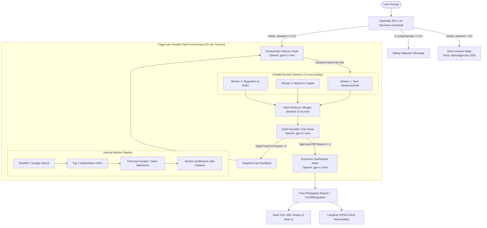

# Deep Research Agent — Architecture & Technical Specification

## 1. System Pattern: Orchestrator-Worker with Dynamic Parallel Fan-Out (Map-Reduce) & Bounded Feedback

The agent architecture uses an **Orchestrator-Worker Pattern** combined with **Dynamic Parallel Fan-Out (Map-Reduce)** and a **Bounded Quality Feedback Loop**.

### Why This Pattern?
- **Avoids the 20–30 Minute Token Burn:** A flat, single-agent loop can wander indefinitely. Decomposing the research into 3 independent parallel streams hits the target **4–6 minute sweet spot**.
- **Bounded Recursive Loop:** The critic is hard-capped at **1 refinement pass**. If metrics, dates, or counterpoints are missing, it triggers a single targeted refinement pass before automatically proceeding to final report synthesis.
- **Durable Execution:** Wrapped in **Trigger.dev v3**, shielding the agent from HTTP server timeouts (10-minute max duration limit).

---

## 2. Architecture Diagram



---

## 3. Agents & Sub-Workers Breakdown

| # | Role / Node | Technology / Model | Function |
| :--- | :--- | :--- | :--- |
| **1** | **Safety Guardrail & Intent Classifier** | `typesafe/jev-1.14` via OpenRouter | Evaluates two non-generative `noul` predicates (`is_inappropriate` and `needs_research`). Rejects toxic prompts and filters out casual greetings. |
| **2** | **Chit-chat / Direct Answer Node** | Groq (`openai/gpt-oss-120b`) | Generates instant, conversational responses in **1–2 seconds** for trivial questions, burning zero search tokens. |
| **3** | **Lead Orchestrator (Planner)** | OpenAI `gpt-4.1-mini` | Decomposes complex queries into exactly 3 structured research sections with 2 optimized search queries each. |
| **4** | **3x Parallel Section Researchers** | LangGraph `Send()` API + `gpt-4.1-mini` | Run concurrently. Each worker executes SerpAPI discovery, scrapes clean markdown via Firecrawl, and drafts a 500-word cited section. |
| **5** | **Chief Scientific Critic** | OpenAI `gpt-4.1-mini` | Audits coverage, hard data metrics, citations, and counterpoints. Enforces bounded loop limit (maximum 1 refinement round). |
| **6** | **Executive Report Synthesizer** | OpenAI `gpt-4.1-mini` | Compiles an authoritative whitepaper with an Executive Summary, Key Strategic Metrics, merged sections, Risk Outlook, and deduplicated Bibliography. |

---

## 4. Technology Stack & Integrations

- **Orchestration Runtime:** `@langchain/langgraph` (v1.5.1) — Pregel graph execution, state reducers, and conditional branching.
- **Background Job Runner:** `@trigger.dev/sdk` (v4.7.4) — Durable execution, retries with exponential backoff, and 10-minute task limits.
- **Observability & Tracing:** `langfuse` & `langfuse-langchain` (v3.39.2) — Full trace lifecycle, spans, token tracking, and latency monitoring on HIPAA Cloud.
- **Search Tooling:**
  - `serpapi` (v2.2.1) — Real-time Google organic search discovery.
  - `@mendable/firecrawl-js` (v4.46.0) — Deep web scraping, stripping DOM bloat to clean markdown, with 6,000-character token guardrails.
- **Models:**
  - `typesafe/jev-1.14`: Strict decision model for noul guardrails ($0.042/M tokens).
  - `openai/gpt-oss-120b` (Groq): High-speed conversational inference.
  - `gpt-4.1-mini` (OpenAI): Core reasoning, research planning, worker drafting, and report synthesis.
- **Frontend / Streaming:** Node.js native HTTP server (`node:http`) streaming Server-Sent Events (SSE) to a minimal ChatGPT-style HTML/CSS/JS interface.

---

## 5. Token & Cost Guardrails

1. **Section Ceiling:** Fixed at 3 sections per topic.
2. **Search Ceiling:** Maximum 2 queries per section, scraping top 2 URLs per query (max 6 scraped pages total).
3. **Payload Truncation:** Scraped markdown is truncated at 6,000 characters before sending to the LLM.
4. **Critic Bound:** Maximum 1 retry pass to ensure execution stays strictly within 4–6 minutes.

---

## 6. How to Run the Project

### Prerequisites
Make sure your environment variables in `.env` are configured:
```env
FIRECRAWL_API_KEY=fc-...
OPENAPI_KEY=sk-proj-...
GROQ_API_KEY=gsk-...
GROQ_MODEL=openai/gpt-oss-120b
OPENROUTER_JEV=sk-or-v1-...
JEV_MODEL=typesafe/jev-1.14
TRIGGER_SECRET_KEY=tr_dev_sk-...
LANGFUSE_PUBLIC_KEY=pk-lf-...
LANGFUSE_SECRET_KEY=sk-lf-...
LANGFUSE_BASE_URL="https://hipaa.cloud.langfuse.com"
```

### 1. Launch the Real-Time SSE Web UI
```bash
npm run ui
```
- Open [http://localhost:3005](http://localhost:3005) in your browser.
- Open Developer Tools (`F12`) to view real-time JEV telemetry in the console.

### 2. Run Direct CLI Benchmark Test
```bash
npm run test:run "Analyze current trends in humanoid robotics in 2025"
```

### 3. Launch Trigger.dev Development Worker
```bash
npm run trigger:dev
```
- Connects local worker to project `proj_fvuyopahfcetqlubfpmx`.
- View and trigger runs live from the [Trigger.dev Dashboard](https://cloud.trigger.dev).
- View traces, tokens, and latency live on your [Langfuse Dashboard](https://hipaa.cloud.langfuse.com).