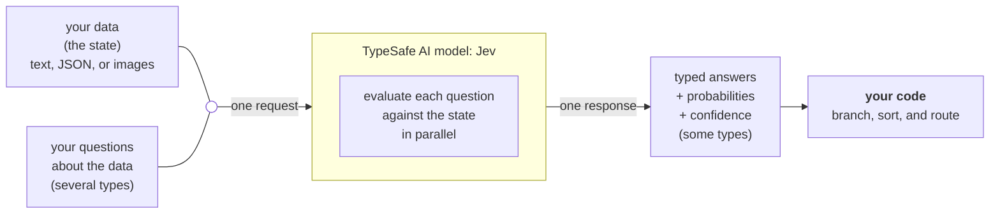
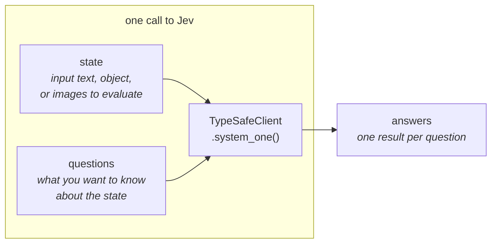
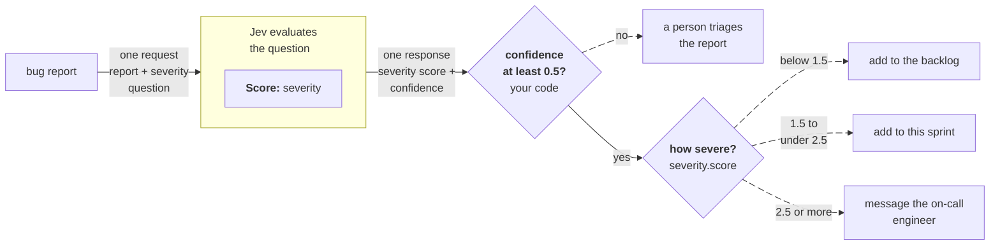

> ## Documentation Index
> Fetch the complete documentation index at: https://docs.typesafe.ai/llms.txt
> Use this file to discover all available pages before exploring further.

# Introduction

> Jev is TypeSafe's flagship model and the first System One model. Send state and typed questions; get structured answers your code can use directly.

Large language models (LLMs) are designed to produce text for humans to read. When you need a model to make a judgment that your code will consume, that creates a mismatch: you are coercing a text-generation system into outputting structured decisions, then parsing the results back into something your code can depend on.

Jev is TypeSafe's flagship model and the first [System One model](https://docs.typesafe.ai/concepts/system-one.md). System One models are built to make fast, structured decisions that software can use directly. Jev evaluates typed *questions* against a *state* and returns structured results directly. No text generation, no parsing. You get typed values and probability distributions that your code can branch on, sort by, and route with. Some question types also return [confidence](https://docs.typesafe.ai/confidence.md), which your code can use to decide whether and how to act on an answer. Each question type's page lists what its answers include.



## TypeSafe primitives

TypeSafe exposes *AI primitives*. Similar to software primitives, our AI primitives are modular, composable, structured, reliable, and fast. Each asks a different type of *question* and returns a different type of answer.

| Question type | Goal | Returns |
| - | - | - |
| [Choice](https://docs.typesafe.ai/primitives/choice.md) | Choose an option from a list | `choice`, `probabilities`, `confidence` |
| [Score](https://docs.typesafe.ai/primitives/score.md) | Score the state on a rubric | `score`, `probabilities`, `confidence` |
| [Noul](https://docs.typesafe.ai/primitives/noul.md) | Is this statement true? | `noul` (0–1) |
| [Box](https://docs.typesafe.ai/primitives/box.md) | Where is it in this image? | `box` (`top`, `bottom`, `left`, `right`), `confidence` |

Any mix of *question* types can go in a single request. Every *question* is evaluated in parallel and in isolation against the same *state* in one go. Adding questions barely changes the response time. Each question is evaluated independently, so adding more questions does not create context-rot.

## Atomic questions, composed in code

System One models work best when each question asks one specific, well-scoped thing. Think of each question as a gut-check determination: the kind of judgment a highly knowledgeable person could make in a few seconds given the right context.

If the question you want to ask would require extended reasoning or weighs multiple independent factors, decompose it. Ask each factor as a separate question, then combine the results with logic in your code. This keeps each individual evaluation reliable and gives you full control over how dimensions are weighted.

For example, instead of "rate this startup pitch," ask separately about market size, technical feasibility, and differentiation. Combine the scores with your own formula. When priorities shift, change a coefficient in your code rather than rewriting a prompt.

## Next steps

* [Quick Start](https://docs.typesafe.ai/introduction/quickstart.md) — Everything you need to get started immediately.
* [AI Primer](https://docs.typesafe.ai/introduction/machine-learning-primer.md) — Why TypeSafe trains models for calibrated decisions instead of generated text.
* [Primitives (Questions)](https://docs.typesafe.ai/primitives) — How to define questions, choose a question type, and ask several at once.
* [Confidence](https://docs.typesafe.ai/confidence.md) — How Jev reports certainty, and how to use it architecturally.
* [Patterns](https://docs.typesafe.ai/patterns.md) — Common patterns for building systems with TypeSafe.


This documentation is built and hosted on [Mintlify](https://mintlify.com), a developer documentation platform.

===========================================================================================================

> ## Documentation Index
> Fetch the complete documentation index at: https://docs.typesafe.ai/llms.txt
> Use this file to discover all available pages before exploring further.

# Quick start

> Get up and running with Jev in 5 minutes.

This guide covers four ways of using Jev, TypeSafe's [System One model](https://docs.typesafe.ai/concepts/system-one.md), namely: [use our SDK](#code-it-your-first-request), [call our API](#call-it-the-api), [use our agent skill](#vibe-it-the-agent-skill), or [try our browser-based Playground](#try-it-the-playground).

Get an API key from the [TypeSafe console](https://console.typesafe.ai/keys).

## The minimum you should know to use Jev effectively

Each call to Jev sends a request, made of a [state](https://docs.typesafe.ai/concepts/state.md) (a simple string or structured object; either can include [images](https://docs.typesafe.ai/images.md)) and a set of [questions](https://docs.typesafe.ai/primitives), and returns one answer per question:



Jev answers these question types, called primitives:

| Question type | Goal | Returns |
| - | - | - |
| [Choice](https://docs.typesafe.ai/primitives/choice.md) | Choose an option from a list | `choice`, `probabilities`, `confidence` |
| [Score](https://docs.typesafe.ai/primitives/score.md) | Score the state on a rubric | `score`, `probabilities`, `confidence` |
| [Noul](https://docs.typesafe.ai/primitives/noul.md) | Is this statement true? | `noul` (0–1) |
| [Box](https://docs.typesafe.ai/primitives/box.md) | Where is it in this image? | `box` (`top`, `bottom`, `left`, `right`), `confidence` |

## Vibe it: the Agent Skill

The fastest way to add Jev to your project is to have your coding agent write the integration with the TypeSafe skill installed.

1. **[Install the TypeSafe skill](https://docs.typesafe.ai/agent-skill.md#installation)** using the Claude Code plugin or `npx skills add typesafe-ai/skills --skill typesafe-ai`. You can also [read SKILL.md on GitHub](https://github.com/typesafe-ai/skills/blob/main/skills/typesafe-ai/SKILL.md).

> [tab] Claude Code
>
> Run these two commands in your terminal:
>
> ```bash theme={null} theme={null}
> claude plugin marketplace add typesafe-ai/skills
> claude plugin install typesafe@typesafe-ai
> ```

> [tab] Other agents
>
> ```bash theme={null} theme={null}
> npx skills add typesafe-ai/skills --skill typesafe-ai
> ```
>
> Choose your agent when prompted. Installation is project-local by default; add `-g` to install globally.

> [tab] Copy to your agent
>
> Paste this prompt into your coding agent:
>
> ```text wrap theme={null} theme={null}
> Install the TypeSafe skill. If you're in Claude Code, run `claude plugin marketplace add typesafe-ai/skills`, then `claude plugin install typesafe@typesafe-ai`. If you're in another agent, run `npx skills add typesafe-ai/skills --skill typesafe-ai` and select your agent. Use one installation method. You can read the skill directly at https://github.com/typesafe-ai/skills/blob/main/skills/typesafe-ai/SKILL.md (raw: https://raw.githubusercontent.com/typesafe-ai/skills/main/skills/typesafe-ai/SKILL.md). Then use the TypeSafe skill when working on this project.
> ```

2. **Tell your coding agent** to use the TypeSafe skill as you build.

```plaintext title="Coding agent prompt" theme={null}
Let's build a simple CLI that uses Jev to evaluate a set of supplied texts on multiple dimensions. Use the TypeSafe skill to understand how to use the TypeSafe API and how to structure the system. Ask me questions about what kinds of texts I want to evaluate and on what dimensions.
```

> [!NOTE]
>
> We suggest that you generate and store your TypeSafe API key in an environment variable (e.g. `TYPESAFE_API_KEY`).

The [Agent Skill](https://docs.typesafe.ai/agent-skill.md) page has more example prompts and fixes for common issues, such as an agent that isn't using the skill.

## Code it: your first request

See how to call Jev from your favourite programming language. The Python, JavaScript, and TypeScript examples use our SDKs; the Bash example calls the API directly.

Create a working directory and set your API key. These setup commands use Bash on macOS, Linux, or Windows with WSL:

```bash wrap theme={null}
mkdir typesafe-quickstart
cd typesafe-quickstart
export TYPESAFE_API_KEY="your-api-key"
```

The example sends a customer support ticket and asks Jev three questions in one request: which team should handle it, how frustrated the customer sounds, and whether the issue is urgent.

> [tab] Python
>
> Requires Python 3.10 or later. Choose a package manager to install the SDK:
>
> > [tab] pip
> >
> > With [pip installed](https://pip.pypa.io/en/stable/installation/), create a virtual environment and add the SDK:
> >
> > ```bash wrap theme={null}
> > python3 -m venv .venv
> > .venv/bin/pip install typesafe-sdk
> > ```
>
> > [tab] uv
> >
> > With [uv installed](https://docs.astral.sh/uv/getting-started/installation/), initialize a project and add the SDK:
> >
> > ```bash wrap theme={null}
> > uv init --bare
> > uv add typesafe-sdk
> > ```
>
> Save as `route_ticket.py`:
>
> ```python wrap theme={null}
> from typesafe_sdk import Choice, Noul, Score, TypeSafeClient
>
> ticket = "Our API integration started returning 500 errors on every request about 20 minutes ago, and we can't process any customer orders until this is fixed."
>
> with TypeSafeClient(model="jev-latest") as client:  # Reads TYPESAFE_API_KEY.
>     response = client.system_one(
>         state=ticket,
>         questions={
>             "department": Choice(
>                 instructions="Which team should handle this",
>                 criteria={
>                     "billing": "Payment or subscription issues",
>                     "technical": "Bugs or integration problems",
>                     "sales": "Pricing or account questions",
>                 },
>             ),
>             "frustration": Score(
>                 instructions="How frustrated the customer appears",
>                 criteria=[
>                     "Calm, just stating facts",
>                     "Frustrated but civil",
>                     "Very angry, strong language",
>                 ],
>             ),
>             "is_urgent": Noul(
>                 instructions="The message conveys urgency or time-sensitivity",
>             ),
>         },
>     )
>
> print(response.choices["department"].choice)
> print(response.scores["frustration"].score)
> print(response.nouls["is_urgent"].noul)
> ```
>
> Run it with either installation method:
>
> ```bash wrap theme={null}
> .venv/bin/python route_ticket.py
> ```

> [tab] JavaScript
>
> Requires Node.js 20 or later. Install the SDK and mark the project as an ES module:
>
> ```bash wrap theme={null}
> npm install @typesafe-ai/sdk
> npm pkg set type=module
> ```
>
> Save as `route_ticket.js`:
>
> ```javascript wrap theme={null}
> import { choice, noul, score, TypeSafeClient } from "@typesafe-ai/sdk";
>
> const ticket = "Our API integration started returning 500 errors on every request about 20 minutes ago, and we can't process any customer orders until this is fixed.";
>
> const client = new TypeSafeClient({ defaultModel: "jev-latest" }); // Reads TYPESAFE_API_KEY.
> const response = await client.systemOne({
>   state: ticket,
>   questions: {
>     department: choice("Which team should handle this", {
>       billing: "Payment or subscription issues",
>       technical: "Bugs or integration problems",
>       sales: "Pricing or account questions",
>     }),
>     frustration: score("How frustrated the customer appears", [
>       "Calm, just stating facts",
>       "Frustrated but civil",
>       "Very angry, strong language",
>     ]),
>     is_urgent: noul("The message conveys urgency or time-sensitivity"),
>   },
> });
>
> console.log(response.answers.department.choice);
> console.log(response.answers.frustration.score);
> console.log(response.answers.is_urgent.noul);
> ```
>
> Run it:
>
> ```bash wrap theme={null}
> node route_ticket.js
> ```

> [tab] TypeScript
>
> Requires Node.js 22.18 or later to run TypeScript directly. Install the SDK and mark the project as an ES module:
>
> ```bash wrap theme={null}
> npm install @typesafe-ai/sdk
> npm pkg set type=module
> ```
>
> Save as `route_ticket.ts`:
>
> ```typescript wrap theme={null}
> import { choice, noul, score, TypeSafeClient } from "@typesafe-ai/sdk";
>
> const ticket = "Our API integration started returning 500 errors on every request about 20 minutes ago, and we can't process any customer orders until this is fixed.";
>
> const client = new TypeSafeClient({ defaultModel: "jev-latest" }); // Reads TYPESAFE_API_KEY.
> const response = await client.systemOne({
>   state: ticket,
>   questions: {
>     department: choice("Which team should handle this", {
>       billing: "Payment or subscription issues",
>       technical: "Bugs or integration problems",
>       sales: "Pricing or account questions",
>     }),
>     frustration: score("How frustrated the customer appears", [
>       "Calm, just stating facts",
>       "Frustrated but civil",
>       "Very angry, strong language",
>     ]),
>     is_urgent: noul("The message conveys urgency or time-sensitivity"),
>   },
> });
>
> console.log(response.answers.department.choice);
> console.log(response.answers.frustration.score);
> console.log(response.answers.is_urgent.noul);
> ```
>
> Run it:
>
> ```bash wrap theme={null}
> node route_ticket.ts
> ```
>
> The SDK infers answer types from your questions, so `response.answers.department.choice` has the type `"billing" | "technical" | "sales"`.

> [tab] Bash
>
> Requires curl 7.76 or later. Save as `route_ticket.sh`:
>
> ```bash wrap theme={null}
> #!/usr/bin/env bash
> set -euo pipefail
> : "${TYPESAFE_API_KEY:?Set TYPESAFE_API_KEY first.}"
>
> curl --fail-with-body --silent --show-error \
>   https://api.typesafe.ai/v1/systemone \
>   -H "Authorization: Bearer $TYPESAFE_API_KEY" \
>   -H "Content-Type: application/json" \
>   --data-binary @- <<'JSON'
> {
>   "state": "Our API integration started returning 500 errors on every request about 20 minutes ago, and we can't process any customer orders until this is fixed.",
>   "model": "jev-latest",
>   "questions": {
>     "department": {
>       "type": "choice",
>       "instructions": "Which team should handle this",
>       "criteria": {
>         "billing": "Payment or subscription issues",
>         "technical": "Bugs or integration problems",
>         "sales": "Pricing or account questions"
>       }
>     },
>     "frustration": {
>       "type": "score",
>       "instructions": "How frustrated the customer appears",
>       "criteria": [
>         "Calm, just stating facts",
>         "Frustrated but civil",
>         "Very angry, strong language"
>       ]
>     },
>     "is_urgent": {
>       "type": "noul",
>       "instructions": "The message conveys urgency or time-sensitivity"
>     }
>   }
> }
> JSON
> ```
>
> Run it:
>
> ```bash wrap theme={null}
> bash route_ticket.sh
> ```

Jev evaluates each question against the same state and returns answers under the IDs you supplied. `choice` is the team label, `score` is the position on the three-level frustration rubric (0–2), and `noul` is the probability of urgency (0–1).

The Python, JavaScript, and TypeScript examples print those three values:

```text Example output theme={null}
technical
0.67
0.99
```

The Bash example prints the raw JSON response on one line. The Raw Response in the next section shows it formatted, with each answer's confidence and probabilities. These are example results; values can change between Jev releases.

The [client SDKs](https://docs.typesafe.ai/sdk.md) pages cover installing the Python and JavaScript SDKs, typed answers, and their retry policy.

## Call it: the API

All four code examples in the previous section use this endpoint. The Bash tab above shows the complete HTTP request without an SDK.

```http theme={null}
POST https://api.typesafe.ai/v1/systemone
Authorization: Bearer <API_KEY>
Content-Type: application/json
```

> [accordion] Raw Response
>
> ```json theme={null}
> {
>   "model": "jev-1.13.0",
>   "answers": {
>     "department": {
>       "type": "choice",
>       "choice": "technical",
>       "confidence": 1.0,
>       "probabilities": {
>         "technical": 1.0,
>         "billing": 0.0,
>         "sales": 0.0
>       }
>     },
>     "frustration": {
>       "type": "score",
>       "score": 0.67,
>       "confidence": 0.5,
>       "legend": {
>         "0": "Calm, just stating facts",
>         "1": "Frustrated but civil",
>         "2": "Very angry, strong language"
>       },
>       "probabilities": {
>         "0": 0.33,
>         "1": 0.67,
>         "2": 0.0
>       }
>     },
>     "is_urgent": {
>       "type": "noul",
>       "noul": 0.99
>     }
>   },
>   "usage": {
>     "input_tokens": 428,
>     "output_tokens": 73
>   }
> }
> ```

The [API Reference](https://docs.typesafe.ai/api) lists every request field, question type, and answer type.

## Try it: the Playground

The Playground runs Jev in the browser: paste a state, add questions, and read the answers without writing code.

1. **Open the [Playground](https://console.typesafe.ai/playground)** and log in.
2. **Paste any text** as the state.

```plaintext title="Sample state" theme={null}
Our API integration started returning 500 errors on every request about 20 minutes ago, and we can't process any customer orders until this is fixed.
```

3. **Add a question.** Try a Noul question: `"Does this message express urgency?"`

```json theme={null}
{
  "urgency": {
    "type": "noul",
    "instructions": "Does this message express urgency?"
  }
}
```

4. **Add more questions.** Mix Noul, Choice, and Score questions in one request and see all results at once.

***

## Next Steps

Composing primitives into larger systems takes some practice, even if you're used to LLMs. The [Machine Learning Primer](https://docs.typesafe.ai/introduction/machine-learning-primer.md) explains why Jev returns calibrated probabilities instead of generated text, and how that changes the way you build with it.

We’d also suggest taking a look at [Primitives](https://docs.typesafe.ai/primitives) and the [Use Case Map](https://docs.typesafe.ai/concepts/use-case-map.md).

1. [Errors and retries](https://docs.typesafe.ai/sdk/python/usage/basic.md#error-handling)
2. [Parallel Questions](https://docs.typesafe.ai/cookbooks/parallel_questions.md)


This documentation is built and hosted on [Mintlify](https://mintlify.com), a developer documentation platform.

====================================================================================================

> ## Documentation Index
> Fetch the complete documentation index at: https://docs.typesafe.ai/llms.txt
> Use this file to discover all available pages before exploring further.

# Example use cases

> Explore TypeSafe use cases by industry and turn promising ideas into software workflows.

Use this map to brainstorm where TypeSafe could fit in your industry. Open the closest industry, scan the example decisions, and adapt them to the documents and actions in your own workflow.

## Example use case categories

> [card] AI Automation Software
>
> Interleave AI with reliable software in a way where you can run it a million times in the background without a human co-pilot. Code owns control flow (not markdown files) while Jev handles the semantic decisions and language understanding.

> [card] Real-time applications
>
> Frontier intelligence at real-time speeds (150ms) means AI can make decisions faster than human perception. Fast and smart enough to be programmed to play games or embedded into a UI.

> [card] AI Map Reduce over Big Data
>
> 100x cheaper means you can process giant datasets. Search for relevant information over giant corpuses, classify giant agent traces, and extract features to make predictions.

> [card] Universal Verification
>
> Verify the input prompt, extractions, reasoning traces, tool calls, or inputs of any other AI. Detect jailbreaks, citation errors, hallucinations, mistakes, or other error-modes that other AIs or LLMs make at a fraction of the cost for the actual LLM call.

> [card] Harness Engineering
>
> Use Jev calls to make your harness smarter - model routing, semantic context retrieval, LLM error detection and guardrails, reasoning trace classification at lightspeed and a fraction of the cost.

## Example automation use cases

> [accordion] Search and retrieval
>
> * Replace or supplement embeddings in RAG pipelines with semantic search, scoring, and ranking.
> * Score query-to-candidate relevance.
> * Rerank results with pairwise comparisons.
> * Cross-encode queries and candidates for higher precision.
> * Select useful context for downstream AI workflows.

> [accordion] Scientific discovery
>
> * Screen papers against inclusion and exclusion criteria for systematic reviews.
> * Label passages in interview transcripts, open-ended survey responses, and field notes using predefined themes or categories.
> * Check whether cited passages support claims in manuscripts and generated summaries.
> * Flag missing methodological details, such as controls, dataset descriptions, and experimental settings.
> * Identify entities and relationships across papers to build research knowledge graphs, linking findings to supporting passages.

> [accordion] Model routing
>
> * Use Jev to build a custom router that chooses which LLM receives each prompt.
> * Set routing rules and thresholds for your specific workflow.
> * Classify intent and domain.
> * Estimate difficulty and risk.
> * Escalate requests that need a more expensive model.

> [accordion] LLM guardrails
>
> * Place semantic checks on every LLM input, output, and tool call at a fraction of the cost of the LLM call.
> * Detect jailbreaks and prompt injection.
> * Identify policy violations and sensitive-data exposure.
> * Detect tool-call errors and response-quality failures in real time.
> * Log structured check results and probabilities to make AI system and harness failures easier to trace.

> [accordion] Semantic code linting
>
> * Use Jev calls to add automated semantic lints to code and writing.
> * Define checks for your team's coding conventions and writing guidelines.
> * Run these checks in CI and flag violations for review.

> [accordion] Feature extraction for predictive modeling
>
> * Use Jev to extract probabilistic features from natural-language data.
> * Combine these features with structured data to train models for tasks with ground-truth outcomes.
> * Use autoresearch workflows to propose feature definitions and evaluate their predictive value against held-out ground truth.

> [accordion] Recruiting
>
> * Evaluate resumes, applications, and interview feedback against explicit, job-related criteria.
> * Identify relevant experience.
> * Score evidence for required competencies.
> * Match candidates to roles.
> * Route candidates to hiring managers or recruiters.
> * Escalate uncertain cases for human review.

> [accordion] Lead generation
>
> * Match company profiles, executive biographies, and inbound messages to an ideal customer profile.
> * Score industry fit and company maturity.
> * Detect buyer relevance, pain points, and purchase intent.
> * Prioritize and route leads.

> [accordion] Customer support
>
> * Classify incoming tickets by issue, product area, and customer intent.
> * Process call transcripts to extract customer issues, commitments, and follow-up actions.
> * Detect urgency, frustration, churn risk, and refund requests.
> * Route cases to the right team, queue, or automated workflow.
> * Verify support responses against policies and the customer's request.

> [accordion] Insurance claims
>
> * Classify first-notice-of-loss reports, adjuster notes, and supporting documents.
> * Detect claim complexity, missing information, and potential fraud indicators.
> * Prioritize claims for straight-through processing or specialist review.
> * Escalate uncertain or high-risk cases to a human adjuster.

> [accordion] Financial crime
>
> * Evaluate transaction narratives, KYC documents, and alert histories for suspicious characteristics.
> * Match entities across inconsistent names, profiles, and records.
> * Prioritize alerts by risk, relevance, and evidence quality.
> * Route ambiguous cases to investigators for review.

> [accordion] Legal and compliance
>
> * Classify contracts, policies, regulatory filings, and marketing claims.
> * Detect missing clauses, prohibited claims, and policy violations.
> * Verify documents against explicit legal or compliance requirements.
> * Escalate high-risk or uncertain findings to counsel or compliance teams.

> [accordion] E-commerce marketplaces
>
> * Classify and normalize product listings across inconsistent seller catalogs.
> * Extract product attributes from titles and descriptions.
> * Detect prohibited listings, counterfeit signals, review abuse, and policy violations.
> * Rank products and route uncertain listings for human review.

> [accordion] Moderation and trust and safety
>
> * Apply company-specific, nuanced criteria to decide which posts meet your moderation standards.
> * Moderate user content and automated conversations across communities, customer support, and SDR workflows.
> * Detect toxicity, harassment, spam, fraud, unsafe advice, personal-data exposure, opt-out requests, and policy-violating claims.
> * Combine severity and confidence to allow, warn, review, or block content.

> [accordion] Advertising
>
> * Evaluate creative assets, campaign copy, landing pages, and placement context.
> * Classify brand safety and audience suitability.
> * Check regulatory compliance and prohibited claims.
> * Evaluate creative quality and ad-to-landing-page alignment.

> [accordion] Gaming
>
> * Evaluate player reports, in-game chat, reviews, and support conversations.
> * Moderate chat and detect abuse, toxicity, or suspicious behavior.
> * Annotate content and score frustration or engagement.
> * Detect churn signals and route player-support requests.

> [accordion] Risk assessment
>
> * Convert incident reports, claims notes, transaction descriptions, and vendor assessments into probabilistic risk indicators.
> * Use these indicators in insurance and underwriting workflows.
> * Classify risk types and detect suspicious characteristics.
> * Score severity and prioritize review.
> * Extract features for broader risk models.

> [accordion] Demand forecasting
>
> * Enrich forecasting models with semantic signals from customer inquiries, sales notes, product reviews, support tickets, and market reports.
> * Extract purchase intent, urgency, and product interest.
> * Detect supply concerns, competitive pressure, and emerging demand themes.
> * Feed those features into a forecasting model alongside historical time-series data.

> [accordion] Graphs and knowledge graphs
>
> * Annotate and verify knowledge graphs with typed semantic decisions.
> * Classify relationships and entity types.
> * Detect contradictions between records or claims.
> * Support probabilistic traversal and hierarchical classification.

## Example task categories

| Decision shape | Reach for it when | Examples |
| - | - | - |
| **Classification** | One known category should win | Intent, topic, department, risk type, entity type |
| **Detection** | You need a probability that one property is present | Spam, fraud, urgency, jailbreaks, sensitive data |
| **Scoring** | The answer belongs on an ordered rubric | Severity, relevance, quality, frustration, suitability |
| **Routing** | A category selects the next code path | Tool use, escalation, model routing, support queues |
| **Search** | You need to find items that match a natural-language query | Semantic search, document discovery, candidate generation |
| **Retrieval** | A workflow needs the most relevant context or records | RAG context, evidence retrieval, knowledge lookup |
| **Ranking** | Items need to be ordered by semantic relevance or quality | Search results, recommendations, candidate prioritization |
| **Verification** | An artifact must be checked for specific failure modes | Citation support, policy violations, tool-call errors, response quality |
| **ML Feature Extraction** | A downstream classical ML model needs semantic signals | Purchase intent, product interest, competitive pressure, churn signals |
| **Structured Data Extraction** | Known fields must be recovered from unstructured input | Candidate attributes, order fields, document labels |


This documentation is built and hosted on [Mintlify](https://mintlify.com), a developer documentation platform.

===================================================================================================

> ## Documentation Index
> Fetch the complete documentation index at: https://docs.typesafe.ai/llms.txt
> Use this file to discover all available pages before exploring further.

# Routing by confidence

> Use confidence as a second axis. The score tells you what; confidence tells you whether to act on it.

A Score answer gives you a position on the scale, `score`, and a [confidence](https://docs.typesafe.ai/confidence.md) from 0 to 1 that says how certain the answer is. Check the confidence first: send an answer whose probability is spread across the scale to a person, and route the rest on the score.

## Example: triaging bug reports

Let's imagine you are building a bug tracker that triages incoming reports. A cosmetic issue can wait in the backlog, a broken feature goes into the current sprint, and anything that stops users completing a core task goes straight to the on-call engineer. A report that doesn't make its severity clear should go to a person before anyone messages the engineer.



### Score how severe the report is

Send the report with one Score question. Its five levels run from a cosmetic issue to a critical one.

Try it in the Playground →

Jev's answer doesn't say whether the update lost the notes or the user deleted them:

```json theme={null}
{
  "model": "jev-1.14.0",
  "answers": {
    "severity": {
      "type": "score",
      "score": 3.19,
      "confidence": 0.34,
      "legend": {
        "0": "Cosmetic: wording, layout, or styling only",
        "1": "Minor: something misbehaves, but users can still do what they wanted",
        "2": "Major with a workaround: a feature is broken, but there is another way to get the job done",
        "3": "Major with no workaround: users cannot complete a core task",
        "4": "Critical: data loss, a security hole, or the product is down for everyone"
      },
      "probabilities": {
        "0": 0.01,
        "1": 0.14,
        "2": 0.07,
        "3": 0.19,
        "4": 0.59
      }
    }
  },
  "usage": {
    "input_tokens": 435,
    "output_tokens": 17
  }
}
```

A score of 3.19 on its own would message the on-call engineer. The probabilities tell a different story: most of the probability is on "critical", in case the update lost the notes, but 0.14 is on "minor", in case the user deleted them. The probability spread brings the confidence down to 0.34.

### Send unsettled scores to a person, route the rest

Check confidence before reading the score, and route on the score only when the check passes.

```python theme={null}
severity = response.answers["severity"]

if severity.confidence < 0.5:
    # The probability is spread across the scale. A person reads the report first.
    send_to_triage(report_id)

elif severity.score < 1.5:
    add_to_backlog(report_id)

elif severity.score < 2.5:
    add_to_sprint(report_id)

else:
    message_on_call(report_id)
```

The "Notes gone?" report goes to triage, where a person can ask the reporter whether the notes were deleted. Reports with a clear severity route straight through, as these recorded `jev-1.14.0` answers show:

| Report | `score` | `confidence` | Outcome |
| - | - | - | - |
| Typo on the settings page | 0.0 | 1.0 | backlog |
| PDF export fails over 50 pages; splitting the document works | 2.0 | 1.0 | this sprint |
| Checkout returns a 500 error for every customer | 3.36 | 0.7 | message on-call |
| Notes gone after the update, or maybe deleted | 3.19 | 0.34 | triage |

## When two levels split the answer

For a Score, if two levels have the highest and equal probabilities, the score is much higher if those two levels are next to each other than if they are not. The further they are apart, the lower the score.
A Score's confidence counts probability on a neighboring level as only a small spread. That can be an issue if you set a threshold between those two levels: an answer split between them can pass a confidence check and land on the wrong side of the threshold. The [Score explorer](https://docs.typesafe.ai/confidence.md#score) shows how the distance between levels changes confidence.

When a decision depends on which side of a level boundary the answer falls, add up the probabilities of the levels on the side that matters:

```python theme={null}
blocked = severity.probabilities[3] + severity.probabilities[4]

if blocked >= 0.3:
    # A real chance users are blocked. Message someone rather than wait for the sprint.
    message_on_call(report_id)
```

[Routing by probability](https://docs.typesafe.ai/patterns/probability-routing.md) builds a whole router on probabilities like this, with a separate threshold for each action.


This documentation is built and hosted on [Mintlify](https://mintlify.com), a developer documentation platform.