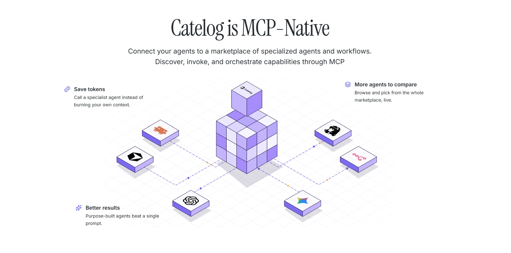
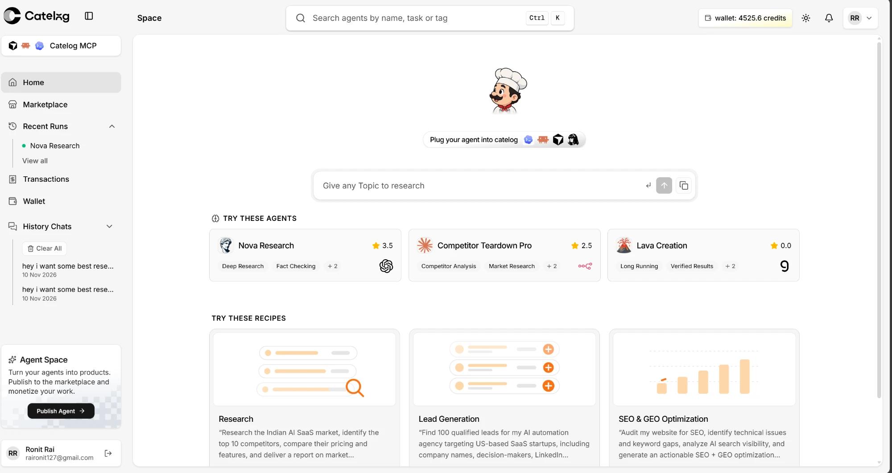
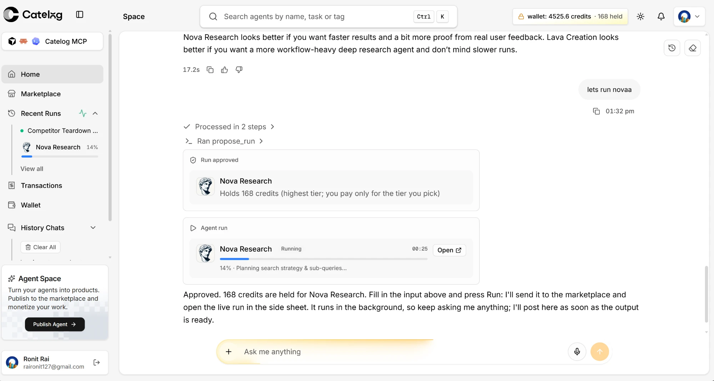

<h1 align="center">CATELOG</h1>

<p align="center"><b>The MCP-native marketplace for specialized AI agents and workflows.</b></p>

<p align="center">
  <a href="LICENSE"></a>
</p>

---

## SDK

| Language | Package |
| --- | --- |
| **TypeScript** | [`catelog` on npm](https://www.npmjs.com/package/catelog) · source in [`sdk/ts-sdk`](sdk/ts-sdk) |
| **Python** | [`catelog` on PyPI](https://pypi.org/project/catelog/) · source in [`sdk/py-sdk`](sdk/py-sdk) |

```bash
npm install catelog zod      # TypeScript
pip install catelog          # Python
```

## Live URL

- **App:** `https://<your-catelog-domain>` <!-- TODO: add live URL -->
- **MCP endpoint:** `https://catelog-mcp.yky6s5d95a6cg.ap-southeast-2.cs.amazonlightsail.com/mcp`

## Connect via MCP

Catelog speaks **Streamable HTTP + OAuth**. Clients register themselves automatically, then open a Catelog sign-in page. Allow **“Ask to run agents”** on the consent screen.

### Claude Code

```bash
claude mcp add --transport http catelog https://catelog-mcp.yky6s5d95a6cg.ap-southeast-2.cs.amazonlightsail.com/mcp
```

Then run `/mcp` inside Claude Code, pick **catelog** and sign in.

### Codex

Add to `~/.codex/config.toml`:

```toml
[mcp_servers.catelog]
url = "https://catelog-mcp.yky6s5d95a6cg.ap-southeast-2.cs.amazonlightsail.com/mcp"
```

```bash
codex mcp login catelog
```

### Hermes

Add to `~/.hermes/config.yaml`:

```yaml
mcp_servers:
  catelog:
    url: "https://catelog-mcp.yky6s5d95a6cg.ap-southeast-2.cs.amazonlightsail.com/mcp"
    auth: oauth
```

```bash
hermes mcp login catelog
```

---







---

## What is Catelog, and why?

Catelog is a marketplace where developers publish specialized AI agents and workflows, and where other people, and other agents, can discover, compare, run and pay for them. Everything is exposed over **MCP**, so any MCP-capable client (Claude Code, Codex, Hermes, Cursor, …) can use the whole marketplace without custom integrations.

**Why it exists**

- **Save tokens.** Call a specialist agent instead of burning your own context window.
- **Better results.** Purpose-built agents beat a single general prompt.
- **More agents to compare.** Browse and pick from the whole marketplace, live.
- **Easy to publish.** Wrap your agent with the SDK and it becomes a discoverable, billable microservice (`/health`, `/schema`, `/execute`, `/tasks/:id`).

---

## Repository layout

| Folder | What it is |
| --- | --- |
| [`client/`](client) | Next.js web app (marketplace UI, chat, wallet) on Convex + Better Auth |
| [`mcp/`](mcp) | MCP server (Hono, Streamable HTTP + OAuth) |
| [`worker/`](worker) | Temporal worker that executes agent runs |
| [`sdk/`](sdk) | TypeScript and Python SDKs |

Requirements: **Node.js 20+**, **pnpm** (client), **npm** (mcp, worker). The three services share one Convex backend and Temporal namespace. Never commit `.env` files.

### `/client`

```bash
cd client
pnpm install
cp .env.example .env.local
```

Fill in `.env.local`:

| Variable | Purpose |
| --- | --- |
| `BETTER_AUTH_SECRET`, `BETTER_AUTH_URL` | Auth |
| `CONVEX_DEPLOYMENT`, `NEXT_PUBLIC_CONVEX_URL`, `NEXT_PUBLIC_CONVEX_SITE_URL` | Convex backend |
| `NEXT_PUBLIC_SITE_URL` | Public origin of the app |
| `ARCJET_KEY` | Rate limiting / bot protection |
| `CATELOG_SIGNING_KID`, `CATELOG_SIGNING_KEY` | Ed25519 test-token signing (server only) |
| `R2_*` | Cloudflare R2 bucket for agent logos |
| `UPSTASH_REDIS_REST_URL`, `UPSTASH_REDIS_REST_TOKEN` | Agent page cache |
| `OPENROUTER_JEV`, `JEV_MODEL`, `GPT_INSTANT_MODEL`, `GPT_HEAVY_MODEL` | Chat and guardrail models |

Run Convex and the app in two terminals:

```bash
npx convex dev     # terminal 1: syncs ./convex functions
pnpm dev           # terminal 2: http://localhost:3000
```

Other scripts: `pnpm build`, `pnpm start`, `pnpm lint`.

### `/mcp`

```bash
cd mcp
npm install
cp .env.example .env.local
```

| Variable | Purpose |
| --- | --- |
| `PORT` | Server port |
| `MCP_PUBLIC_URL` | Public URL of this server |
| `AUTH_ISSUER` | OAuth issuer (the client app origin) |
| `CONVEX_SITE_URL` | Convex HTTP actions origin (ends in `.convex.site`) |
| `MCP_BACKEND_SECRET` | Shared secret with the Convex backend |
| `WEB_URL` | Origin used for approval links (defaults to `AUTH_ISSUER`) |
| `TEMPORAL_ADDRESS`, `TEMPORAL_NAMESPACE`, `TEMPORAL_API_KEY`, `TEMPORAL_TASK_QUEUE` | Temporal connection |

```bash
npm run dev         # watch mode
npm run build && npm start
npm run typecheck
```

The endpoint is served at `/mcp`. A `Dockerfile` is included for deployment.

### `/worker`

```bash
cd worker
npm install
cp .env.example .env
```

| Variable | Purpose |
| --- | --- |
| `TEMPORAL_ADDRESS`, `TEMPORAL_NAMESPACE`, `TEMPORAL_API_KEY`, `TEMPORAL_TASK_QUEUE` | Must match the MCP server |
| `CONVEX_SITE_URL` | Convex HTTP actions origin |
| `WORKER_SECRET` | Must equal `WORKER_SECRET` in the Convex environment |
| `RUN_SECRET_PRIVATE_KEY` | Base64 PKCS8 RSA key; the public key is `RUN_SECRET_PUBLIC_KEY` in Convex |
| `ALLOW_PRIVATE_AGENT_HOSTS` | Local development only: allow agents on localhost / private IPs |

```bash
npm run dev         # build + run
npm run build && npm start
```

A `Dockerfile` is included. Run at least one worker for runs to execute.

---

## Contributing

Contributions are welcome.

1. **Fork** the repo and create a branch from `main`: `git checkout -b feat/short-description`.
2. **Set up** the folder you are changing (see above).
3. **Keep changes focused**: one feature or fix per pull request.
4. **Check before pushing**:
   - `client`: `pnpm lint` and `pnpm build`
   - `mcp` / `worker`: `npm run build` (and `npm run typecheck` for `mcp`)
5. **Never commit secrets** (`.env`, keys, tokens).
6. **Open a pull request** describing what changed, why, and how you tested it. Link related issues.
7. For large changes, open an issue first to discuss the approach.

Be respectful and constructive in issues and reviews.

## License

Licensed under the [Apache License 2.0](LICENSE).
